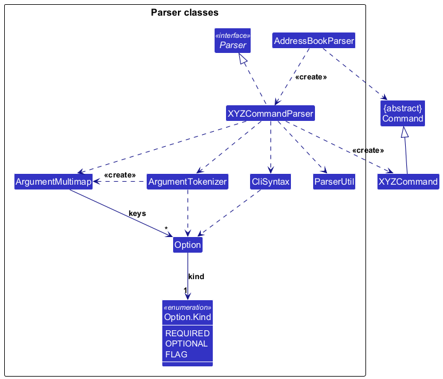
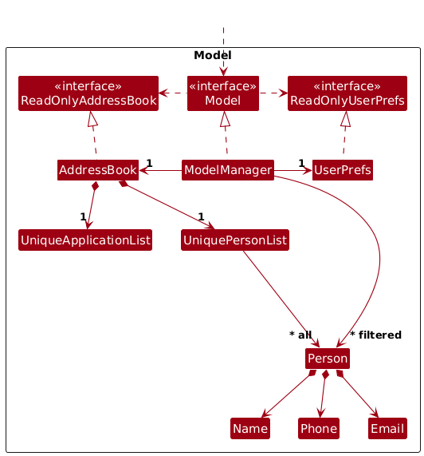
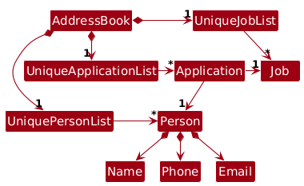

* Table of Contents
{:toc}

--------------------------------------------------------------------------------------------------------------------

## **Acknowledgements**

* _{List the sources of reused or adapted ideas, code, documentation, and third-party libraries here, with links to the originals.}_

--------------------------------------------------------------------------------------------------------------------

## **Setting up, getting started**

Refer to the guide [_Setting up and getting started_](SettingUp.md).

--------------------------------------------------------------------------------------------------------------------

## **Design**

:bulb: **Tip:** The `.puml` files used to create diagrams are in `docs/diagrams`. Refer to the [_PlantUML Tutorial_ at se-edu/guides](https://se-education.org/guides/tutorials/plantUml.html) to learn how to create and edit diagrams.

### Architecture

The ***Architecture Diagram*** given above explains the high-level design of the App.

The following provides a quick overview of the main components and their interactions.

**Main components of the architecture**

**`Main`** (consisting of classes [`Main`](https://github.com/se-edu/addressbook-level3/tree/master/src/main/java/seedu/address/Main.java) and [`MainApp`](https://github.com/se-edu/addressbook-level3/tree/master/src/main/java/seedu/address/MainApp.java)) is in charge of the app launch and shut down.
* At app launch, it initializes the other components in the correct sequence, and connects them up with each other.
* At shut down, it shuts down the other components and invokes cleanup methods where necessary.

The bulk of the app's work is done by the following four components:

* [**`UI`**](#ui-component): The UI of the App.
* [**`Logic`**](#logic-component): The command executor.
* [**`Model`**](#model-component): Holds the data of the App in memory.
* [**`Storage`**](#storage-component): Reads data from, and writes data to, the hard disk.

[**`Commons`**](#common-classes) represents a collection of classes used by multiple other components.

**How the architecture components interact with each other**

The *Sequence Diagram* below shows how the components interact with each other for the scenario where the user issues the command `delete 1`.

Each of the four main components (also shown in the diagram above),

* defines its *API* in an `interface` with the same name as the Component.
* provides its functionality through a concrete `{Component Name}Manager` class that implements the corresponding API interface.

For example, the `Logic` component defines its API in `Logic.java` and implements it in `LogicManager.java`. Other components interact with a component through its interface rather than its concrete class, preventing them from coupling to that component's implementation, as illustrated in the following partial class diagram.

The sections below give more details of each component.

### UI component

The **API** of this component is specified in [`Ui.java`](https://github.com/se-edu/addressbook-level3/tree/master/src/main/java/seedu/address/ui/Ui.java)

The UI consists of a `MainWindow` and its parts, such as `CommandBox`, `ResultDisplay`, `ApplicantListPanel`, and `StatusBarFooter`. All of these, including `MainWindow`, inherit from the abstract `UiPart` class, which captures common behavior among classes that represent visible GUI parts.

The `UI` component uses the JavaFX UI framework. The layouts of these UI parts are defined in matching `.fxml` files in `src/main/resources/view`. For example, [`MainWindow.fxml`](https://github.com/se-edu/addressbook-level3/tree/master/src/main/resources/view/MainWindow.fxml) specifies the layout of [`MainWindow`](https://github.com/se-edu/addressbook-level3/tree/master/src/main/java/seedu/address/ui/MainWindow.java).

The `UI` component,

* executes user commands using the `Logic` component.
* listens for changes to `Model` data so that the UI can be updated with the modified data.
* keeps a reference to the `Logic` component, because the `UI` relies on the `Logic` to execute commands.
* depends on some classes in the `Model` component because it displays `Applicant` objects from the model.

### Logic component

**API** : [`Logic.java`](https://github.com/se-edu/addressbook-level3/tree/master/src/main/java/seedu/address/logic/Logic.java)

Here's a (partial) class diagram of the `Logic` component:

The sequence diagram below illustrates the interactions within the `Logic` component, taking `execute("delete 1")` API call as an example.

:information_source: **Note:** The lifeline for `DeleteCommandParser` should end at the destroy marker (X), but due to a limitation of PlantUML, it continues to the end of the diagram.

How the `Logic` component works:

1. When `Logic` is called upon to execute a command, the command is passed to an `AddressBookParser` object, which in turn creates a parser that matches the command (e.g., `DeleteCommandParser`) and uses it to parse the command.
1. This results in a `Command` object (more precisely, an object of one of its subclasses e.g., `DeleteCommand`) which is executed by the `LogicManager`.
1. The command can communicate with the `Model` when it is executed (e.g. to delete an applicant). 
   Note that although this is shown as a single step in the diagram above for simplicity, the code can require several interactions between the command object and the `Model` to complete the operation.
1. The result of the command execution is encapsulated as a `CommandResult` object which is returned from `Logic`.

Here are the other classes in `Logic` (omitted from the class diagram above) that are used for parsing a user command:

This partial diagram omits class members and generic type parameters. Dashed dependencies represent temporary use
or access to static members: `CliSyntax` defines static `Option` constants. In contrast, `ArgumentMultimap` stores
references to its `Option` keys, and each `Option` stores exactly one `Option.Kind`, so those links are associations.

How the parsing works:
* When called upon to parse a user command, the `AddressBookParser` class creates an `XYZCommandParser` (`XYZ` is a placeholder for the specific command name, e.g., `AddCommandParser`). The parser uses the other classes shown above to parse the user command and create an `XYZCommand` object (e.g., `AddCommand`). The `AddressBookParser` returns that object as a `Command` object.
* All `XYZCommandParser` classes, such as `AddCommandParser` and `DeleteCommandParser`, implement the `Parser` interface so they can be treated similarly where appropriate, for example during testing.

See [Command parsing and validation](#command-parsing-and-validation) for the option rules and a parsing walkthrough.

### Model component
**API** : [`Model.java`](https://github.com/se-edu/addressbook-level3/tree/master/src/main/java/seedu/address/model/Model.java)

The `Model` component,

* stores the address book data i.e., all `Applicant` objects (which are contained in a `UniqueApplicantList` object).
* stores the `Applicant` objects selected by the current filter, such as search results, in a separate _filtered_ list. It exposes this list as an unmodifiable `ObservableList<Applicant>` that the UI can observe and bind to, so the UI updates when the list changes.
* stores a `UserPrefs` object that represents the user’s preferences (currently, just the GUI settings). This is exposed to the outside as a `ReadOnlyUserPrefs` object.
* does not depend on any of the other three components (as the `Model` represents data entities of the domain, they should make sense on their own without depending on other components)

The `Application` model class in [`Application.java`](../src/main/java/seedu/address/model/application/Application.java)
represents one applicant’s job application. It contains a reference to the applicant’s `Applicant`, together with an
immutable job and application status. Applicant identity is determined using `Applicant#isSameApplicant`, while
`Application#equals` compares the complete applicant, job identity, and status. A job has a non-blank role and a
separate description; statuses are restricted to the case-sensitive values `accept`, `reject`, and
`pending`. `AddressBook` stores these applications separately from its applicant list and keeps at most one application
per applicant. `addp` creates an application for an existing job and an applicant in the displayed list, and `set` updates the
status of an existing application without changing its job. Deleting an applicant also
deletes that applicant's application, and editing an applicant updates the applicant stored on the application.
`deletep INDEX` removes only the displayed applicant's application through `Model#deleteApplication` and
`AddressBook#removeApplication`, preserving the applicant, job, and applicant filter. It returns the applicant
in `ViewRequest.applicant` to select the applicants view and refresh their details. An applicant without an application
produces an error.
Deleting an applicant or application never removes a job.

`AddressBook` also keeps a separate `UniqueJobList` of open roles. A job is identified by its role:
duplicate roles are rejected, surrounding spaces are ignored, and other differences in case are kept.
`addj` adds a role and shows the full job list. `viewj` lists every role, and `viewj -f KEYWORD` limits that list to roles whose description contains `KEYWORD`, ignoring case. `deletej` removes the role at the displayed index, which follows the current filter.
`editj INDEX -j JOB_ROLE` replaces a role at its displayed index, rejecting a role that
matches another stored job. `Model#setJob` delegates to `AddressBook#setJob` and `UniqueJobList#setJob`,
which replaces the job at the same position and enforces uniqueness. `UniqueApplicationList#setJob` updates
matching applications to reference the edited job, keeping their applicants and statuses. This prevents stale role
references that the storage loader would reject.
After editing, the command clears the job filter and returns the edited job in `CommandResult` so it
is visible and selected even if the new role no longer matches the previous filter.
These four commands ask the UI to show the job list and the selected role's detail panel. The panel shows
that role only. It does not list applicants by comparing the role text with application job descriptions.
The `view` command selects an applicant from the currently displayed applicant list and shows the applicant's
details. `list` and `viewa` show the applicant list. `viewp` shows each application with its applicant, job, and status.
`find`, `add`, `edit`, and `clear` also request the applicants view. `add` and `edit` select the changed applicant
so the detail panel shows that person. `clear` replaces a deleted-applicant snapshot with the empty panel.
`help` does not request a view, so that snapshot stays in place.

Deleting a job cascades through `AddressBook#removeJob`
to `UniqueApplicationList#removeForJob`, removing every application whose `Job#equals` matches the deleted role
while keeping all applicants. Matching uses the exact, case-sensitive job role after trimming surrounding spaces,
consistent with job identity. The cascade operates on all stored applications regardless of the current filters,
so subsequent saves contain no applications for the deleted role. Adding an application does not add a job to this list.
This cascade does not change the JSON format introduced by the job model.
Jobs are stored in the same JSON address book under `jobs`.

:information_source: **Note:** The alternative, arguably more object-oriented, design below keeps a unique list of tags in `AddressBook`, and each `Applicant` references tags from that list. This lets `AddressBook` maintain one `Tag` object per unique tag instead of each `Applicant` holding its own `Tag` objects. 

### Storage component

**API** : [`Storage.java`](https://github.com/se-edu/addressbook-level3/tree/master/src/main/java/seedu/address/storage/Storage.java)

The `Storage` component,
* can save both address book data and user preference data in JSON format, and read them back into corresponding objects.
* is implemented by `StorageManager`, which delegates the actual JSON file access to `JsonAddressBookStorage` and `JsonUserPrefsStorage` (one class per data file).
* depends on some classes in the `Model` component (because the `Storage` component's job is to save/retrieve objects that belong to the `Model`)

### Common classes

Classes used by multiple components are in the `seedu.address.commons` package.

--------------------------------------------------------------------------------------------------------------------

## **Implementation**

This section describes some noteworthy details on how certain features are implemented.

### Command parsing and validation

Commands with named options use `ArgumentTokenizer#tokenizeOptions` to share the rules for recognising options,
resolving aliases, and rejecting malformed arguments. Each command parser supplies its own option definitions and
then validates the extracted values. Commands that only take an index, such as `delete`, use `ParserUtil#parseIndex`
directly instead.

#### Parsing responsibilities

The [parser class diagram](#logic-component) shows how these classes collaborate:

| Class | Responsibility |
| --- | --- |
| `AddressBookParser` | Separates the command word from its arguments and dispatches to the matching command parser. |
| `CliSyntax` | Defines shared `Option` objects, including short and long aliases. |
| `Option` | Describes the accepted aliases and whether an option is required, optional, or a flag. |
| `ArgumentTokenizer` | Recognises option tokens, maps aliases to their configured `Option`, and validates argument structure. |
| `ArgumentMultimap` | Stores extracted strings under `Option` keys and exposes any positional preamble. |
| `ParserUtil` | Converts extracted strings to validated values, such as an `Index`, `Name`, `Phone`, or `Email`. |
| Command parser | Selects the options allowed for its command, applies command-specific rules, and constructs a `Command`. |

`Option.Kind` determines how the tokenizer handles an option:

| Kind | Rule |
| --- | --- |
| `REQUIRED` | The option must appear once with a non-empty value. |
| `OPTIONAL` | The option may be omitted, but must have a non-empty value when present. |
| `FLAG` | The option may be omitted and takes no value when present. |

Flag support is provided by the tokenizer and covered by its tests; the shared options in `CliSyntax` use the
required and optional kinds. The tokenizer trims surrounding whitespace from values and accepts options in any order.
It recognises lowercase, hyphen-prefixed option tokens separated by whitespace, such as `-n`, `-name`, or `-job`.
An embedded hyphen, such as the one in `alice-tan@example.com`, does not start an option.

#### Example: adding an applicant

Consider `add -name Alice -p 91234567 -email alice@example.com`:

1. `AddressBookParser` recognises `add` and passes the remaining arguments to `AddCommandParser`.
1. `AddCommandParser` calls `tokenizeOptions` with `NO_PREAMBLE` and the required name, phone, and email options
   from `CliSyntax`.
1. The tokenizer maps `-name`, `-p`, and `-email` to `OPTION_NAME_REQ`, `OPTION_PHONE_REQ`, and `OPTION_EMAIL_REQ`.
   Each alias resolves to the same configured `Option` object as its short form. The resulting `ArgumentMultimap`
   stores `Alice`, `91234567`, and `alice@example.com` under those keys.
1. After the tokenizer checks that every required option is present with a value and no option is repeated,
   `AddCommandParser` retrieves the strings and uses `ParserUtil` to validate the name, phone, and email.
1. The parser constructs a `Person` and returns an `AddCommand`. Checking whether the applicant's name or email
   conflicts with an existing record happens when the command executes against the model.

For an indexed command such as `addp 1 -j Engineer`, `AddApplicationCommandParser` enables `HAS_PREAMBLE`.
The tokenizer stores the leading `1` under the internal `Option.OPTION_EMPTY` key, which is exposed through
`ArgumentMultimap#getPreamble`. Allowing a preamble does not require it to contain an index: the command parser
must call `ParserUtil#parseIndex` to reject a missing, non-integer, or non-positive index. The command later checks
whether the index exists in the filtered applicant list. The job option is required, while the omitted status
defaults to `pending` in `AddApplicationCommandParser`.

#### Validation and error handling

The tokenizer rejects unknown option tokens, repeated options (including mixed aliases such as `-n` and `-name`),
missing required options, empty option values, values supplied to flags, and positional text when `NO_PREAMBLE`
is selected. `ArgumentMultimap` can hold multiple values for a key, but `tokenizeOptions` rejects duplicates before
returning it to the command parser.

Command parsers decide how to present these errors. For example, `AddCommandParser` wraps tokenizer errors in its
command usage message, while an invalid phone or email produces the corresponding field constraint message.
Additional rules stay in the command parser: `EditCommandParser` configures optional fields but separately requires
at least one field to be supplied. Parsing failures throw `ParseException` before a command is executed.

#### Design considerations

* **Shared tokenizer with command-specific configuration:** Keeping alias resolution and structural checks in one
  tokenizer gives commands consistent rules. Implementing these checks separately in every parser would allow more
  specialised grammars, but would duplicate validation and make changes harder to apply consistently.
* **Reject duplicate options:** Rejecting repeated aliases prevents ambiguous input from silently replacing an earlier
  value. Accepting the last value would allow easy overrides, but could hide an accidental repeated field.

The parsing rules are exercised in `ArgumentTokenizerTest`, including aliases, option kinds, preambles, malformed input,
and conflicting option definitions. `AddCommandParserTest`, `AddApplicationCommandParserTest`, and
`EditCommandParserTest` cover the command-specific validation and error messages.

### \[Proposed\] Undo/redo feature

#### Proposed Implementation

The proposed undo/redo mechanism is facilitated by `VersionedAddressBook`. It extends `AddressBook` with an undo/redo history, stored internally as an `addressBookStateList` and `currentStatePointer`. Additionally, it implements the following operations:

* `VersionedAddressBook#commit()` — Saves the current address book state in its history.
* `VersionedAddressBook#undo()` — Restores the previous address book state from its history.
* `VersionedAddressBook#redo()` — Restores a previously undone address book state from its history.

These operations are exposed in the `Model` interface as `Model#commitAddressBook()`, `Model#undoAddressBook()` and `Model#redoAddressBook()` respectively.

Given below is an example usage scenario and how the undo/redo mechanism behaves at each step.

Step 1. The user launches the application for the first time. The `VersionedAddressBook` will be initialized with the initial address book state, and the `currentStatePointer` pointing to that single address book state.

Step 2. The user executes `delete 5` command to delete the 5th applicant in the address book. The `delete` command calls `Model#commitAddressBook()`, causing the modified state of the address book after the `delete 5` command executes to be saved in the `addressBookStateList`, and the `currentStatePointer` is shifted to the newly inserted address book state.

Step 3. The user executes `add n/David …​` to add a new applicant. The `add` command also calls `Model#commitAddressBook()`, causing another modified address book state to be saved into the `addressBookStateList`.

:information_source: **Note:** If a command fails its execution, it will not call `Model#commitAddressBook()`, so the address book state will not be saved into the `addressBookStateList`.

Step 4. The user now decides that adding the applicant was a mistake, and decides to undo that action by executing the `undo` command. The `undo` command will call `Model#undoAddressBook()`, which will shift the `currentStatePointer` once to the left, pointing it to the previous address book state, and restores the address book to that state.

:information_source: **Note:** If the `currentStatePointer` is at index 0, pointing to the initial AddressBook state, then there are no previous AddressBook states to restore. The `undo` command uses `Model#canUndoAddressBook()` to check if this is the case. If so, it will return an error to the user rather
than attempting to perform the undo.

The following sequence diagram shows how an undo operation goes through the `Logic` component:

:information_source: **Note:** The lifeline for `UndoCommand` should end at the destroy marker (X), but due to a limitation of PlantUML, it continues to the end of the diagram.

Similarly, how an undo operation goes through the `Model` component is shown below:

The `redo` command does the opposite — it calls `Model#redoAddressBook()`, which shifts the `currentStatePointer` once to the right, pointing to the previously undone state, and restores the address book to that state.

:information_source: **Note:** If the `currentStatePointer` is at index `addressBookStateList.size() - 1`, pointing to the latest address book state, then there are no undone AddressBook states to restore. The `redo` command uses `Model#canRedoAddressBook()` to check if this is the case. If so, it will return an error to the user rather than attempting to perform the redo.

Step 5. The user then decides to execute the command `list`. Commands that do not modify the address book, such as `list`, will usually not call `Model#commitAddressBook()`, `Model#undoAddressBook()` or `Model#redoAddressBook()`. Thus, the `addressBookStateList` remains unchanged.

Step 6. The user executes `clear`, which calls `Model#commitAddressBook()`. Since the `currentStatePointer` is not pointing at the end of the `addressBookStateList`, all address book states after the `currentStatePointer` will be purged. Reason: It no longer makes sense to redo the `add n/David …​` command. This is the behavior that most modern desktop applications follow.

The following activity diagram summarizes what happens when a user executes a new command:

#### Design considerations:

**Aspect: How undo & redo execute:**

* **Alternative 1 (current choice):** Saves the entire address book.
  * Pros: Easy to implement.
  * Cons: May have performance issues in terms of memory usage.

* **Alternative 2:** Individual command knows how to undo/redo by
  itself.
  * Pros: Will use less memory (e.g. for `delete`, just save the applicant being deleted).
  * Cons: We must ensure that the implementation of each individual command is correct.

_{more aspects and alternatives to be added}_

### \[Proposed\] Data archiving

_{Explain here how the data archiving feature will be implemented}_

--------------------------------------------------------------------------------------------------------------------

## **Documentation, logging, testing, dev-ops**

* [Documentation guide](Documentation.md)
* [Testing guide](Testing.md)
* [Logging guide](Logging.md)
* [DevOps guide](DevOps.md)

--------------------------------------------------------------------------------------------------------------------

## **Appendix: Requirements**

### Product Scope
**Target User Profile**

Recruiters
- managing application pipelines for 100s of students and multiple job listings
- working under HR
- who are actively looking for a good management app
- who have a relatively streamlined hiring process
- who are also directly in charge of contacting the candidates
- who are working in a multi-role environment (e.g. there are also interviewers who interview the candidates)
- who prefer desktop apps over other types of applications
- who type fast
- who prefers typing to mouse interactions
- who is comfortable using CLI apps.

**Value Proposition:**
The application will manage students applying to
a role in a company.
Recruiters can use the application to
keep track of student applications for job roles,
as well as to look up the list of
employees to contact if there are changes to
a student’s application status.

### User stories

Priorities: High (must have) - `* * *`, Medium (nice to have) - `* *`, Low (unlikely to have) - `*`

| Priority | As a …​                                | I want to …​                                                         | So that I can…​                                             |
| -------- |----------------------------------------|----------------------------------------------------------------------|-------------------------------------------------------------|
| `* * *`  | recruiter                              | add an applicant                                                     | start tracking applicants                                   |
| `* * *`  | recruiter                              | delete an applicant                                                  | clear my contacts after finishing an application            |
| `* * *`  | recruiter                              | view all applicants as individual entries                            | get a bird’s-eye view of the current information to process |
| `* * *`  | recruiter                              | modify an application status (pending/accept/reject)                 | keep track of which state each application is in            |
| `* *`    | recruiter                              | get an accept/reject email template for an application               | prepare my entire email in one application                  |
| `* *`    | recruiter                              | edit an applicant’s details                                          | correct wrong or missing information                        |
| `* *`    | recruiter                              | add a job role                                                       | start tracking applicants                                   |
| `* *`    | recruiter                              | delete a job role                                                    | clear my contacts after finishing an application            |
| `* *`    | recruiter                              | view all job roles as individual entries                             | get a bird’s-eye view of the current information to process |
| `* *`    | beginner user                          | view the list of commands                                            | understand what the app can do                              |
| `* *`    | HR admin                               | filter applications by resume                                        | find relevant applicants                                    |
| `* *`    | HR admin                               | filter people by roles                                               | view specific people such as interviewers and applicants    |
| `*`      | recruiter                              | edit a job role’s details (status, title, description, etc.)         | correct wrong or missing information                        |
| `*`      | recruiter                              | match job roles to applicants                                        | avoid manually searching for a matching applicant           |
| `*`      | new user who is migrating to LinkedOut | import a list of applicants and applications from an existing system | migrate seamlessly with little issues                       |
| `*`      | new user who is migrating to LinkedOut | import a list of demanded roles                                      | save time entering them manually                            |
| `*`      | experienced user                       | use auto-complete commands                                           | do my work faster                                           |
| `*`      | beginner user                          | go through an onboarding process                                     | learn how to use the application                            |
| `*`      | recruiter                              | modify an accept/reject email template                               | configure the email appropriately                           |
| `*`      | recruiter                              | draft multiple emails through the application at once                | easily mass-send accept/reject emails                       |

### Use cases

**System:** LinkedOut

**Use case:** UC01 - Add an applicant and their application

**Actor:** User

**MSS**

1.  User requests to add an applicant with their name and email.
2.  LinkedOut adds the applicant and displays the updated applicant list.
3.  User requests to add an application to the applicant, providing the job description and optionally the application status.
4.  LinkedOut adds the application and displays the applicant's updated details.

    Use case ends.

**Extensions**

* 1a. The applicant's name or email is invalid or missing.

  * 1a1. LinkedOut shows an error message.

    Use case resumes at step 1.

* 1b. Another applicant has the same name or email.

  * 1b1. LinkedOut shows an error message.

    Use case resumes at step 1.

* 1c. LinkedOut is unable to complete the request.

  * 1c1. LinkedOut shows an error message.

    Use case ends.

* 3a. The specified applicant does not exist.

  * 3a1. LinkedOut shows an error message.

    Use case resumes at step 3.

* 3b. The applicant already has an application.

  * 3b1. LinkedOut shows an error message.

    Use case resumes at step 3.

* 3c. The application details are invalid or missing.

  * 3c1. LinkedOut shows an error message.

    Use case resumes at step 3.

* 3d. LinkedOut is unable to complete the request.

  * 3d1. LinkedOut shows an error message.

    Use case ends.

**System:** LinkedOut

**Use case:** UC02 - Review and update an application

**Actor:** User

**MSS**

1.  User requests to view a specific applicant.
2.  LinkedOut displays the applicant's details and application.
3.  User requests to update the application's status.
4.  LinkedOut updates the status and displays the applicant's updated details.

    Use case ends.

**Extensions**

* 1a. The specified applicant does not exist.

  * 1a1. LinkedOut shows an error message.

    Use case resumes at step 1.

* 1b. The applicant does not have an application.

  * 1b1. LinkedOut displays the applicant's details without an application.

    Use case ends.

* 3a. The requested status is invalid.

  * 3a1. LinkedOut shows an error message.

    Use case resumes at step 3.

* 3b. The application already has the requested status.

  * 3b1. LinkedOut informs the user that no changes were made.

    Use case ends.

* 3c. LinkedOut is unable to complete the request.

  * 3c1. LinkedOut shows an error message.

    Use case ends.

**System:** LinkedOut

**Use case:** UC03 - Delete an applicant

**Actor:** User

**MSS**

1.  User requests to delete a specific applicant.
2.  LinkedOut deletes the applicant and their application, if one exists, and displays the updated applicant list.

    Use case ends.

**Extensions**

* 1a. The specified applicant does not exist.

  * 1a1. LinkedOut shows an error message.

    Use case resumes at step 1.

* 1b. LinkedOut is unable to complete the request.

  * 1b1. LinkedOut shows an error message.

    Use case ends.

*{More to be added}*

### Non-Functional Requirements

1.  Should work on any _mainstream OS_ as long as it has Java `25` or above installed.
2.  Should be able to hold up to 1000 applicants and applications without noticeable sluggishness in performance for typical usage.
3.  A user with above average typing speed for regular English text (i.e. not code, not system admin commands) should be able to accomplish most of the tasks faster using commands than using the mouse.
4.  A new user should be able to add a new applicant or application immediately upon app launch.
5.  Every command should finish within 2s (for up to 1000 applicants/applications).
6.  Should not use more than 2 GB of RAM.

### Glossary

* **Mainstream OS**: Windows, Linux, Unix, or macOS
* **Applicant**: An applicant registered in LinkedOut with a name and email address, whose job application can be tracked.
* **Application**: A record linking an applicant to an existing job and an application status. An applicant can have at most one application.
* **Job**: An open role stored in the job list, identified by its role name and accompanied by a description.
* **Job role**: The name identifying a job, matched exactly after trimming surrounding spaces.
* **Job description**: The additional text describing a job. It does not determine the job's identity.
* **Application status**: The recorded outcome of an application: `accept` (accepted), `reject` (rejected), or `pending` (awaiting a decision). These values are case-sensitive.
* **Applicant index**: The number used in commands to identify an applicant in the applicant list, starting from 1.

--------------------------------------------------------------------------------------------------------------------

## **Appendix: Instructions for manual testing**

Given below are instructions to test the app manually.

:information_source: **Note:** These instructions only provide a starting point for testers to work on;
testers are expected to do more *exploratory* testing.

### Launch and shutdown

1. Initial launch

   1. Download the JAR file and copy it into an empty folder.

   1. Double-click the JAR file. 
      Expected: The GUI opens with a set of sample contacts. The window size may not be optimal.

1. Saving window preferences

   1. Resize the window to an optimal size. Move the window to a different location. Close the window.

   1. Relaunch the app by double-clicking the JAR file. 
       Expected: The most recent window size and location are retained.

1. _{ more test cases …​ }_

### Deleting an applicant

1. Deleting an applicant while all applicants are being shown

   1. Prerequisites: List all applicants using the `list` command, with multiple applicants in the list.

   1. Test case: `delete 1` 
      Expected: The first contact is deleted from the list. The status message shows the deleted contact's details.

   1. Test case: `delete 0` 
      Expected: No applicant is deleted. The status message shows error details.

   1. Other incorrect delete commands to try: `delete`, `delete x`, `...` (where x is larger than the list size) 
      Expected: Similar to previous.

1. _{ more test cases …​ }_

### Saving data

1. Dealing with missing/corrupted data files

   1. _{Explain how to simulate missing or corrupted data files and state the expected behavior.}_

1. _{ more test cases …​ }_
