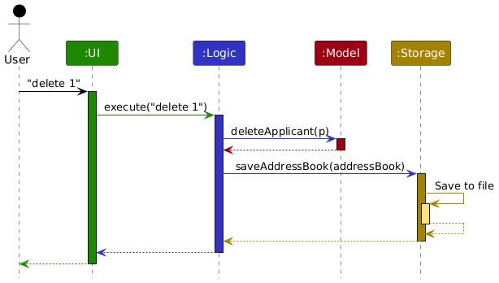
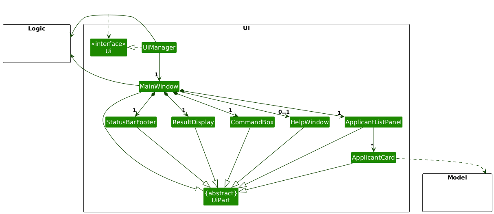
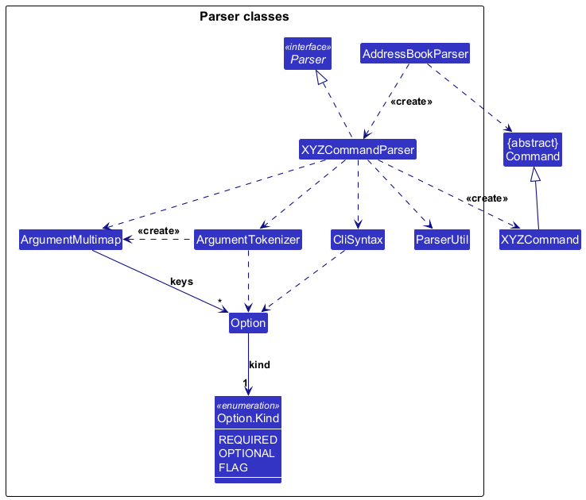
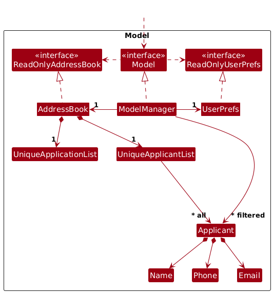
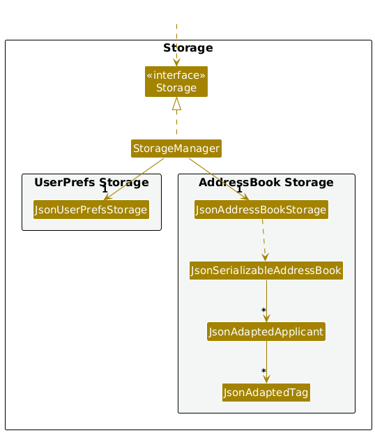

LinkedOut is a desktop recruitment tracker for one recruiter, built on AddressBook-Level3. It manages
applicant contacts, job roles, and one application per applicant, with records stored locally as JSON.
The code retains the `seedu.address` package and the `AddressBook` name from the foundation.
An `Applicant` represents an applicant; `AddressBook` holds applicants, applications, and jobs.

* Table of Contents
{:toc}

--------------------------------------------------------------------------------------------------------------------

## **Acknowledgements**

* LinkedOut adapts the code and documentation of [AddressBook-Level3](https://github.com/se-edu/addressbook-level3),
  created by the [SE-EDU initiative](https://se-education.org).
* AI tools (including but not limited to Codex, Claude Code, Cursor, and Orca) are heavily used in the implementation of the project, including but not limited to:
  * Functional code and comments
  * Documentation
  * Tests
  * Code quality review
* The application uses [JavaFX](https://openjfx.io/) for its UI, [Jackson](https://github.com/FasterXML/jackson)
  for JSON storage, and [JUnit 5](https://github.com/junit-team/junit5) for testing.

--------------------------------------------------------------------------------------------------------------------

## **Setting up, getting started**

Refer to the guide [_Setting up and getting started_](SettingUp.md).

--------------------------------------------------------------------------------------------------------------------

## **Design**

:bulb: **Tip:** The `.puml` files used to create diagrams are in `docs/diagrams`. Refer to the [_PlantUML Tutorial_ at se-edu/guides](https://se-education.org/guides/tutorials/plantUml.html) to learn how to create and edit diagrams.

### Architecture

The ***Architecture Diagram*** given above explains the high-level design of the App.

The following provides a quick overview of the main components and their interactions.

**Main components of the architecture**

**`Main`** (consisting of classes [`Main`](https://github.com/AY2627S1-CS2103T-T14-3/tp/blob/master/src/main/java/seedu/address/Main.java) and [`MainApp`](https://github.com/AY2627S1-CS2103T-T14-3/tp/blob/master/src/main/java/seedu/address/MainApp.java)) is in charge of the app launch and shut down.
* At app launch, it initializes the other components in the correct sequence, and connects them up with each other.
* At shut down, it shuts down the other components and invokes cleanup methods where necessary.

The bulk of the app's work is done by the following four components:

* [**`UI`**](#ui-component): The UI of the App.
* [**`Logic`**](#logic-component): The command executor.
* [**`Model`**](#model-component): Holds the data of the App in memory.
* [**`Storage`**](#storage-component): Reads data from, and writes data to, the hard disk.

[**`Commons`**](#common-classes) represents a collection of classes used by multiple other components.

**How the architecture components interact with each other**

The *Sequence Diagram* below shows how the components interact with each other for the scenario where the user issues the command `delete 1`.

Each of the four main components (also shown in the diagram above),

* defines its *API* in an `interface` with the same name as the Component.
* provides its functionality through a concrete `{Component Name}Manager` class that implements the corresponding API interface.

For example, the `Logic` component defines its API in `Logic.java` and implements it in `LogicManager.java`. Other components interact with a component through its interface rather than its concrete class, preventing them from coupling to that component's implementation, as illustrated in the following partial class diagram.

The sections below give more details of each component.

### UI component

The **API** of this component is specified in [`Ui.java`](https://github.com/AY2627S1-CS2103T-T14-3/tp/blob/master/src/main/java/seedu/address/ui/Ui.java)

This partial diagram shows `MainWindow`, its console, the three list panels, and the two detail panels.
The Applicants and Applications views share `ApplicantDetailPanel`; the Jobs view uses `JobDetailPanel`.
These parts inherit from `UiPart`, which provides FXML loading and shared UI behavior. Inheritance links,
list-cell cards, JavaFX controls, and the `ListNavigation` helper are omitted for readability.

`ListNavigation` moves selection in the active list when Up or Down is pressed from the command box or
list. The command box keeps keyboard focus. Text areas, copyable detail values, and other controls retain
their normal arrow-key behavior; `MainWindow#handleListNavigation` checks the event target before navigating.

`MainWindow` reads the filtered applicant and job predicates to display search-result totals and keywords.
`NameContainsKeywordsPredicate#getKeywords` and `JobDescriptionContainsKeywordPredicate#getKeywords` expose
those keywords. The Applications view uses the applicant predicate, so its heading reports matching applicants
rather than the number of applications. List-change listeners refresh headings after record changes, including undo.

Applicant and job detail avatars use the uppercase initial of each of the first two words.
Initial extraction preserves complete Unicode code points, including supplementary characters.

The `UI` component uses the JavaFX UI framework. The layouts of these UI parts are defined in matching `.fxml` files in `src/main/resources/view`. For example, [`MainWindow.fxml`](https://github.com/AY2627S1-CS2103T-T14-3/tp/blob/master/src/main/resources/view/MainWindow.fxml) specifies the layout of [`MainWindow`](https://github.com/AY2627S1-CS2103T-T14-3/tp/blob/master/src/main/java/seedu/address/ui/MainWindow.java).

The `UI` component,

* executes user commands using the `Logic` component.
* listens for changes to `Model` data so that the UI can be updated with the modified data.
* keeps a reference to the `Logic` component, because the `UI` relies on the `Logic` to execute commands.
* depends on some classes in the `Model` component because it displays `Applicant` objects from the model.

### Logic component

**API** : [`Logic.java`](https://github.com/AY2627S1-CS2103T-T14-3/tp/blob/master/src/main/java/seedu/address/logic/Logic.java)

Here's a (partial) class diagram of the `Logic` component:

The sequence diagram below illustrates the interactions within the `Logic` component, taking `execute("delete 1")` API call as an example.

The sequence shows a successful deletion with a valid index and a successful save. Errors and lower-level
model operations are omitted. The parser is temporary, while the command result carries the deleted
applicant's former details for the UI.

How the `Logic` component works:

1. When `Logic` is called upon to execute a command, it passes the command to `AddressBookParser`. For commands such as `delete`, `clear`, and `viewp`, it creates the matching command parser and uses it to parse the arguments. `help` and `list` are constructed directly.
1. This results in a `Command` object (more precisely, an object of one of its subclasses e.g., `DeleteCommand`) which is executed by the `LogicManager`.
1. The command can communicate with the `Model` when it is executed (e.g. to delete an applicant). 
   The sequence shows the applicant lookup and application lookup before deletion; the model handles dependent-record removal internally.
1. The result of the command execution is encapsulated as a `CommandResult` object which is returned from `Logic`.
1. If the command changed the stored applicants, jobs, or applications, `LogicManager` remembers the previous address book. `undo` restores the newest remembered copy and does not itself become another undo step. The history is kept in memory for the session only.

Here are the other classes in `Logic` (omitted from the class diagram above) that are used for parsing a user command:

This partial diagram omits class members and generic type parameters. Dashed dependencies represent temporary use
or access to static members: `CliSyntax` defines static `Option` constants. In contrast, `ArgumentMultimap` stores
references to its `Option` keys, and each `Option` stores exactly one `Option.Kind`, so those links are associations.

How the parsing works:
* For commands with a dedicated parser, `AddressBookParser` creates an `XYZCommandParser` (`XYZ` is a placeholder for the specific command name, e.g., `AddCommandParser`). The parser uses the relevant classes shown above to parse the arguments and create an `XYZCommand` object (e.g., `AddCommand`). `AddressBookParser` returns it as a `Command` object. Commands such as `help` and `list` are constructed directly.
* All `XYZCommandParser` classes, such as `AddCommandParser` and `DeleteCommandParser`, implement the `Parser` interface so they can be treated similarly where appropriate, for example during testing.

See [Command parsing and validation](#command-parsing-and-validation) for the option rules and a parsing walkthrough.

### Model component
**API** : [`Model.java`](https://github.com/AY2627S1-CS2103T-T14-3/tp/blob/master/src/main/java/seedu/address/model/Model.java)

The model diagram shows the three record collections, application references, filtered views, and bounded
undo snapshots. `Application.Status` and other value-object details are omitted for readability.

The `Model` component,

* stores applicants, jobs, and applications in `UniqueApplicantList`, `UniqueJobList`, and `UniqueApplicationList`.
* stores the `Applicant` objects selected by the current filter, such as search results, in a separate _filtered_ list. It exposes a `FilteredList<Applicant>` that the UI observes for record updates and inspects for its active predicate. Jobs have an equivalent filtered list.
* stores a `UserPrefs` object that represents the user’s preferences (currently, just the GUI settings). This is exposed to the outside as a `ReadOnlyUserPrefs` object.
* does not depend on any of the other three components (as the `Model` represents data entities of the domain, they should make sense on their own without depending on other components)

The `Application` model class in [`Application.java`](https://github.com/AY2627S1-CS2103T-T14-3/tp/blob/master/src/main/java/seedu/address/model/application/Application.java)
represents one applicant’s job application. It contains a reference to the applicant’s `Applicant`, together with an
immutable job and application status. Applicant identity is determined using `Applicant#isSameApplicant`, while
`Application#equals` compares the complete applicant, job identity, and status. A job has a non-blank role and a
separate description; statuses are restricted to the case-sensitive values `accept`, `reject`, and
`pending`. `AddressBook` stores these applications separately from its applicant list and keeps at most one application
per applicant. `addp` creates an application for an existing job and an applicant in the displayed list, and `set` updates the
status of an existing application without changing its job. Deleting an applicant also
deletes that applicant's application, and editing an applicant updates the applicant stored on the application.
`deletep INDEX` removes only the displayed applicant's application through `Model#deleteApplication` and
`AddressBook#removeApplication`, preserving the applicant, job, and applicant filter. It returns the applicant
in `ViewRequest.applicant` to select the applicants view and refresh their details. An applicant without an application
produces an error.
Deleting an applicant or application never removes a job.

`AddressBook` also keeps a separate `UniqueJobList` of open roles. A job is identified by its role:
duplicate roles are rejected, surrounding spaces are ignored, and other differences in case are kept.
`addj` adds a role with an optional description and shows the full job list. `viewj` lists every role, and
`viewj -f KEYWORD` filters the combined `ROLE : DESCRIPTION` text by a case-insensitive substring.
`deletej` removes the role at the displayed index, which follows the current filter.
`editj INDEX [-j JOB_ROLE] [-d JOB_DESCRIPTION]` replaces a job at its displayed index with a new job with the specified
fields modified. There must be at least one modified field provided. If there exists another job with the same job role
as the would-be-new job, the command will fail instead. `Model#setJob` delegates to `AddressBook#setJob` and
`UniqueJobList#setJob`, which replaces the job at the same position and enforces uniqueness.
`UniqueApplicationList#setJob` updates all matching applications to reference the edited job, keeping their applicants and
statuses. Description-only edits also take effect immediately. This prevents stale role references that the storage loader
would reject.
After editing, the command clears the job filter and returns the edited job in `CommandResult` so it
is visible and selected even if the new role no longer matches the previous filter.
These four commands ask the UI to show the job list and the selected role's detail panel. The panel shows
that role only. It does not list applicants by comparing the role text with application job descriptions.
The `view INDEX` command selects an applicant from the currently displayed applicant list and shows the applicant's
details. Bare `view` shows the current applicant list, preserving its filter and selection; `list` shows all applicants.
Bare `viewp` shows each application with its applicant, job, and status. `viewp INDEX` selects the application
belonging to the applicant at that index in `Model#getFilteredApplicantList`, matching the applicant index printed
by `ApplicationListPanel`. Application indexes can therefore have gaps and do not follow application storage order.
`viewj INDEX` selects from `Model#getFilteredJobList`. Indexed view commands preserve filters and stored data;
`viewj` without arguments still resets the job filter. A job index cannot be combined with `-f`.
Selections are returned through the existing `ViewRequest.applicant`, `ViewRequest.application`, and `ViewRequest.job`
factories, which let `MainWindow` switch views, select the record, and refresh the detail panel.
`find`, `add`, `edit`, and `clear` also request the applicants view. `add` and `edit` select the changed applicant
so the detail panel shows that applicant. `clear` replaces a deleted-applicant snapshot with the empty panel.
`help` does not request a view, so that snapshot stays in place.

Deleting a job cascades through `AddressBook#removeJob`
to `UniqueApplicationList#removeForJob`, removing every application whose `Job#equals` matches the deleted role
while keeping all applicants. Matching uses the exact, case-sensitive job role after trimming surrounding spaces,
consistent with job identity. The cascade operates on all stored applications regardless of the current filters,
so subsequent saves contain no applications for the deleted role. Adding an application does not add a job to this list.
This cascade does not change the JSON format introduced by the job model.
Jobs are stored in the same JSON address book under `jobs`.

### Storage component

Null records inside the saved `applicants`, `jobs`, or `applications` arrays are rejected through
`IllegalValueException`, which storage translates into `DataLoadingException`. Startup then uses an empty
address book, following the same recovery path as other invalid records.

`JsonUtil.readJsonFile` also rejects a root-level JSON `null` with `DataLoadingException`.
Only a missing file returns an empty optional; a file containing `null` follows the invalid-file recovery path.

`JsonUserPrefsStorage` rejects explicit null GUI settings as a loading error so startup uses default preferences.
Omitting the GUI settings field still uses its default value.

**API** : [`Storage.java`](https://github.com/AY2627S1-CS2103T-T14-3/tp/blob/master/src/main/java/seedu/address/storage/Storage.java)

The `Storage` component,
* can save both address book data and user preference data in JSON format, and read them back into corresponding objects.
* is implemented by `StorageManager`, which delegates the actual JSON file access to `JsonAddressBookStorage` and `JsonUserPrefsStorage` (one class per data file).
* depends on some classes in the `Model` component (because the `Storage` component's job is to save/retrieve objects that belong to the `Model`)

`JsonSerializableAddressBook` uses the top-level keys `applicants`, `jobs`, and `applications`. Applicant
entries store `name`, `phone`, and `email`; the inherited `persons` key is not an alias for `applicants`.

`JsonAdaptedJob` stores each job as an object containing `role` and `description`, both in the top-level `jobs`
array and in each application's `job` field. `role` must be non-blank; `description` must be a non-null string,
although an empty string is valid. `Job` strips surrounding whitespace from both fields. Duplicate jobs are
rejected by role, independently of their descriptions.

`JsonSerializableAddressBook#toModelType` loads applicants, then jobs, then applications. A missing `jobs` or
`applications` array is treated as empty. `JsonAdaptedApplication#toModelType` resolves the applicant by exact
name and the job by role equality against those already loaded. It uses the stored job from `jobs`, so that
job's description takes precedence over the description embedded in the application. Unknown applicants,
unknown roles, and duplicate applications cause loading to fail.

The job role/description format introduced in PR #130 has no automatic migration from the earlier string job
format or from job objects without a role. Such files must be backed up and converted before loading; see
[Job data format in the User Guide](UserGuide.md#job-data-format).

### Common classes

Classes used by multiple components are in the `seedu.address.commons` package.

--------------------------------------------------------------------------------------------------------------------

## **Implementation**

This section describes some noteworthy details on how certain features are implemented.

### Job roles and descriptions

`Job` is an immutable value object with separate `role` and `description` strings. `Job#equals` and
`Job#hashCode` use only the stripped, case-sensitive role. Consequently, `UniqueJobList` rejects the same role
with a different description, while allowing different roles to share a description. The single-argument
constructor supplies the default description `No information ~`.

`AddJobCommandParser` accepts a required role (`-j` or `-job`) and an optional description (`-d`, `-desc`, or
`-description`). `EditJobCommandParser` accepts an index and optional role and description fields, requiring
at least one field. It stores supplied values in `EditJobDescriptor`. `EditJobCommand` builds the replacement
from those values and the existing job, preserving each omitted field. See
[Editing a job in the User Guide](UserGuide.md#editing-a-job-editj).

Despite its name, `JobDescriptionContainsKeywordPredicate` searches `Job#toString`, which returns
`role + " : " + description`. It lowercases both that text and the keyword using `Locale.ROOT`, then calls
`contains`. Thus filtering matches either field, including partial words, and treats a multi-word keyword as
one substring. Filtering does not change job identity or the exact role lookup used by `addp`.

### Command parsing and validation

Commands with named options use `ArgumentTokenizer#tokenizeOptions` to share the rules for recognising options,
resolving aliases, and rejecting malformed arguments. Each command parser supplies its own option definitions and
then validates the extracted values. Commands that only take an index, such as `delete`, use `ParserUtil#parseIndex`
directly instead.

#### Parsing responsibilities

The [parser class diagram](#logic-component) shows how these classes collaborate:

| Class | Responsibility |
| --- | --- |
| `AddressBookParser` | Separates the command word from its arguments and dispatches to the matching command parser. |
| `CliSyntax` | Defines shared `Option` objects, including short and long aliases. |
| `Option` | Describes the accepted aliases and whether an option is required, optional, or a flag. |
| `ArgumentTokenizer` | Recognises option tokens, maps aliases to their configured `Option`, and validates argument structure. |
| `ArgumentMultimap` | Stores extracted strings under `Option` keys and exposes any positional preamble. |
| `ParserUtil` | Converts extracted strings to validated values, such as an `Index`, `Name`, `Phone`, or `Email`. |
| Command parser | Selects the options allowed for its command, applies command-specific rules, and constructs a `Command`. |

`ClearCommandParser` accepts only blank arguments; extra text produces a usage error before any data changes.
`ViewApplicationCommandParser` accepts either blank arguments or a single positive applicant index, using
`ParserUtil#parseIndex` for the latter. An invalid index produces the `viewp` usage error. The command checks
whether that applicant and their application exist when it executes.

On successful `clear`, `ClearCommand` passes a new empty `AddressBook` to `Model#setAddressBook`, replacing all
applicants, applications, and jobs, and requests the applicants view. `LogicManager` then saves the resulting data.

`Option.Kind` determines how the tokenizer handles an option:

| Kind | Rule |
| --- | --- |
| `REQUIRED` | The option must appear once with a non-empty value. |
| `OPTIONAL` | The option may be omitted, but must have a non-empty value when present. |
| `FLAG` | The option may be omitted and takes no value when present. |

Flag support is provided by the tokenizer and covered by its tests; the shared options in `CliSyntax` use the
required and optional kinds. The tokenizer trims surrounding whitespace from values and accepts options in any order.
It recognises lowercase, hyphen-prefixed option tokens separated by whitespace, such as `-n`, `-name`, or `-job`.
Option boundaries use Java whitespace (`Character.isWhitespace`), matching `String.strip()` when trimming values.
An embedded hyphen, such as the one in `alice-tan@example.com`, does not start an option.

#### Example: adding an applicant

Consider `add -name Alice -p 91234567 -email alice@example.com`:

1. `AddressBookParser` recognises `add` and passes the remaining arguments to `AddCommandParser`.
2. `AddCommandParser` calls `tokenizeOptions` with `NO_PREAMBLE` and the required name, phone, and email options
   from `CliSyntax`.
3. The tokenizer maps `-name`, `-p`, and `-email` to `OPTION_NAME_REQ`, `OPTION_PHONE_REQ`, and `OPTION_EMAIL_REQ`.
   Each alias resolves to the same configured `Option` object as its short form. The resulting `ArgumentMultimap`
   stores `Alice`, `91234567`, and `alice@example.com` under those keys.
4. After the tokenizer checks that every required option is present with a value and no option is repeated,
   `AddCommandParser` retrieves the strings and uses `ParserUtil` to validate the name, phone, and email.
5. The parser constructs an `Applicant` and returns an `AddCommand`. Checking whether the applicant's name or email
   conflicts with an existing record happens when the command executes against the model.

For an indexed command such as `addp 1 -j Engineer`, `AddApplicationCommandParser` enables `HAS_PREAMBLE`.
The tokenizer stores the leading `1` under the internal `Option.OPTION_EMPTY` key, which is exposed through
`ArgumentMultimap#getPreamble`. Allowing a preamble does not require it to contain an index: the command parser
must call `ParserUtil#parseIndex` to reject a missing, non-integer, or non-positive index. The command later checks
whether the index exists in the filtered applicant list. The job option is required, while the omitted status
defaults to `pending` in `AddApplicationCommandParser`.

#### Validation and error handling

The tokenizer rejects unknown option tokens, repeated options (including mixed aliases such as `-n` and `-name`),
missing required options, empty option values, values supplied to flags, and positional text when `NO_PREAMBLE`
is selected. `ArgumentMultimap` can hold multiple values for a key, but `tokenizeOptions` rejects duplicates before
returning it to the command parser.

Command parsers decide how to present these errors. For example, `AddCommandParser` wraps tokenizer errors in its
command usage message, while an invalid phone or email produces the corresponding field constraint message.
Additional rules stay in the command parser: `EditCommandParser` configures optional fields but separately requires
at least one field to be supplied. Parsing failures throw `ParseException` before a command is executed.

#### Design considerations

* **Shared tokenizer with command-specific configuration:** Keeping alias resolution and structural checks in one
  tokenizer gives commands consistent rules. Implementing these checks separately in every parser would allow more
  specialised grammars, but would duplicate validation and make changes harder to apply consistently.
* **Reject duplicate options:** Rejecting repeated aliases prevents ambiguous input from silently replacing an earlier
  value. Accepting the last value would allow easy overrides, but could hide an accidental repeated field.

The parsing rules are exercised in `ArgumentTokenizerTest`, including aliases, option kinds, preambles, malformed input,
and conflicting option definitions. `AddCommandParserTest`, `AddApplicationCommandParserTest`, and
`EditCommandParserTest` cover the command-specific validation and error messages.

### Undoing record changes

The implemented `undo` command restores applicants, jobs, and applications from an in-memory history owned
by `ModelManager`. There is no `redo` command.
For command syntax and examples, see [Undoing the last change in the User Guide](UserGuide.md#undoing-the-last-change-undo).

#### Recording a change

1. `LogicManager#execute` parses the command and, unless it is an `UndoCommand`, copies the current records
   with `new AddressBook(model.getAddressBook())` before executing it.
2. After execution, `storedRecordsChanged` compares the previous and resulting records. It checks job
   descriptions separately because `Job#equals` compares only roles. A description-only edit therefore
   creates an undo entry even though the job's identity has not changed.
3. If the records differ, `Model#rememberStateForUndo` adds the previous state to the front of
   `ModelManager.previousAddressBooks`, a `Deque<ReadOnlyAddressBook>`. The deque keeps at most ten states;
   adding an eleventh drops the oldest.
4. `LogicManager` saves the resulting records through `Storage` using the normal command save path.

Commands that only change a filter, selection, or view do not create an entry. A command that leaves the
records unchanged also creates no entry. Parsing and command-execution exceptions exit before history is
recorded. Saving happens after the records and history have changed: a save failure reports an error but
is not a transaction rollback.

#### Restoring a change

`UndoCommand#execute` calls `Model#undoAddressBook`. When a remembered state exists, `ModelManager` removes
the newest state and passes it to `setAddressBook`, which resets the existing address book's records.
This restores related records together, including applications removed by an applicant or job deletion.
It also restores all records removed by `clear`.

On success, the command returns `Undone the last change.` without a view request, so the current tab stays
selected. Observable lists update, and the existing applicant and job filters remain active. Filters, list
selections, and window preferences are not part of the saved record snapshot. A restored record can therefore
remain hidden by a filter; use `list` or `viewj` to show the full corresponding list.

An undo command does not create another history entry. Repeated commands consume earlier states until the
deque is empty, at which point `UndoCommand` throws a `CommandException` with `There is no change to undo.`.
A successful undo is saved by `LogicManager` just like other successful commands. History itself is not
serialized and starts empty when the application restarts.

#### Design considerations

* **Whole-record snapshots:** Copying the address book keeps restoration of applicants, jobs, and dependent
  applications together. This is simpler than defining inverse operations for every mutating command,
  especially cascading deletions, but uses memory proportional to the number and size of retained states.
* **Bounded session history:** Keeping ten previous states limits retained snapshots. It allows several
  corrections within a session without introducing persistent history or redo behavior.

`LogicManagerTest` covers undoing deletions, stepping through successive changes, restoring a description-only
edit, and preserving history after a failed deletion. `AddressBookParserTest` covers the argument-free syntax
and rejects `undo 1` and the case-mismatched command `Undo`.

--------------------------------------------------------------------------------------------------------------------

## **Documentation, logging, testing, dev-ops**

* [Documentation guide](Documentation.md)
* [Testing guide](Testing.md)
* [Logging guide](Logging.md)
* [DevOps guide](DevOps.md)

--------------------------------------------------------------------------------------------------------------------

## **Appendix: Requirements**

### Product Scope
**Target User Profile**

Recruiters
- managing application pipelines for 100s of students and multiple job listings
- working under HR
- who are actively looking for a good management app
- who have a relatively streamlined hiring process
- who are also directly in charge of contacting the candidates
- who are working in a multi-role environment (e.g. there are also interviewers who interview the candidates)
- who prefer desktop apps over other types of applications
- who type fast
- who prefers typing to mouse interactions
- who is comfortable using CLI apps.

**Value Proposition:**
LinkedOut helps a recruiter manage student applicants and their applications across multiple job roles.
Applicant contact details, job descriptions, and application outcomes are stored together locally, so the
recruiter can review whom to contact and where each application stands using text commands.

### User stories

These stories capture product requirements, including ideas beyond the implemented scope. Refer to the
[User Guide](UserGuide.md#features) for the commands supported by this version.

Priorities: High (must have) - `* * *`, Medium (nice to have) - `* *`, Low (unlikely to have) - `*`

| Priority | As a …​                                | I want to …​                                                         | So that I can…​                                             |
| -------- |----------------------------------------|----------------------------------------------------------------------|-------------------------------------------------------------|
| `* * *`  | recruiter                              | add an applicant                                                     | start tracking applicants                                   |
| `* * *`  | recruiter                              | delete an applicant                                                  | clear my contacts after finishing an application            |
| `* * *`  | recruiter                              | view all applicants as individual entries                            | get a bird’s-eye view of the current information to process |
| `* * *`  | recruiter                              | modify an application status (pending/accept/reject)                 | keep track of which state each application is in            |
| `* *`    | recruiter                              | get an accept/reject email template for an application               | prepare my entire email in one application                  |
| `* *`    | recruiter                              | edit an applicant’s details                                          | correct wrong or missing information                        |
| `* *`    | recruiter                              | add a job role                                                       | start tracking applicants                                   |
| `* *`    | recruiter                              | delete a job role                                                    | clear my contacts after finishing an application            |
| `* *`    | recruiter                              | view all job roles as individual entries                             | get a bird’s-eye view of the current information to process |
| `* *`    | beginner user                          | view the list of commands                                            | understand what the app can do                              |
| `* *`    | HR admin                               | filter applications by resume                                        | find relevant applicants                                    |
| `* *`    | HR admin                               | filter people by roles                                               | view specific people such as interviewers and applicants    |
| `*`      | recruiter                              | edit a job role’s details (status, title, description, etc.)         | correct wrong or missing information                        |
| `*`      | recruiter                              | match job roles to applicants                                        | avoid manually searching for a matching applicant           |
| `*`      | new user who is migrating to LinkedOut | import a list of applicants and applications from an existing system | migrate seamlessly with little issues                       |
| `*`      | new user who is migrating to LinkedOut | import a list of demanded roles                                      | save time entering them manually                            |
| `*`      | experienced user                       | use auto-complete commands                                           | do my work faster                                           |
| `*`      | beginner user                          | go through an onboarding process                                     | learn how to use the application                            |
| `*`      | recruiter                              | modify an accept/reject email template                               | configure the email appropriately                           |
| `*`      | recruiter                              | draft multiple emails through the application at once                | easily mass-send accept/reject emails                       |

### Use cases

**System:** LinkedOut

**Use case:** UC01 - Add an applicant and their application

**Actor:** User

**MSS**

1.  User requests to add an applicant with their name, phone number, and email.
2.  LinkedOut adds the applicant and displays the updated applicant list.
3.  User requests to add an application to the applicant, identifying an existing job role and optionally the application status.
4.  LinkedOut adds the application and displays the applicant's updated details.

    Use case ends.

**Extensions**

* 1a. The applicant's name, phone number, or email is invalid or missing.

  * 1a1. LinkedOut shows an error message.

    Use case resumes at step 1.

* 1b. Another applicant has the same name or email, ignoring case.

  * 1b1. LinkedOut shows an error message.

    Use case resumes at step 1.

* 1c. LinkedOut is unable to complete the request.

  * 1c1. LinkedOut shows an error message.

    Use case ends.

* 3a. The specified applicant does not exist.

  * 3a1. LinkedOut shows an error message.

    Use case resumes at step 3.

* 3b. The applicant already has an application.

  * 3b1. LinkedOut shows an error message.

    Use case resumes at step 3.

* 3c. The role is not in the job list, or the application details are invalid or missing.

  * 3c1. LinkedOut shows an error message.

    Use case resumes at step 3.

* 3d. LinkedOut is unable to complete the request.

  * 3d1. LinkedOut shows an error message.

    Use case ends.

**System:** LinkedOut

**Use case:** UC02 - Review and update an application

**Actor:** User

**MSS**

1.  User requests to view a specific applicant.
2.  LinkedOut displays the applicant's details and application.
3.  User requests to update the application's status.
4.  LinkedOut updates the status and displays the applicant's updated details.

    Use case ends.

**Extensions**

* 1a. The specified applicant does not exist.

  * 1a1. LinkedOut shows an error message.

    Use case resumes at step 1.

* 1b. The applicant does not have an application.

  * 1b1. LinkedOut displays the applicant's details without an application.

    Use case ends.

* 3a. The requested status is invalid.

  * 3a1. LinkedOut shows an error message.

    Use case resumes at step 3.

* 3b. The application already has the requested status.

  * 3b1. LinkedOut shows the usual status-update confirmation and the applicant's details; the stored status remains the same.

    Use case ends.

* 3c. LinkedOut is unable to complete the request.

  * 3c1. LinkedOut shows an error message.

    Use case ends.

**System:** LinkedOut

**Use case:** UC03 - Delete an applicant

**Actor:** User

**MSS**

1.  User requests to delete a specific applicant.
2.  LinkedOut deletes the applicant and their application, if one exists, and displays the updated applicant list.

    Use case ends.

**Extensions**

* 1a. The specified applicant does not exist.

  * 1a1. LinkedOut shows an error message.

    Use case resumes at step 1.

* 1b. LinkedOut is unable to complete the request.

  * 1b1. LinkedOut shows an error message.

    Use case ends.

### Non-Functional Requirements

These are design targets; this section does not report measured performance results.

1.  Should work on Windows, Linux, and macOS with Java `25` installed.
2.  Should be able to hold up to 1000 applicants and applications without noticeable sluggishness in performance for typical usage.
3.  A user with above average typing speed for regular English text (i.e. not code, not system admin commands) should be able to accomplish most of the tasks faster using commands than using the mouse.
4.  A new user should be able to add a new applicant or application immediately upon app launch.
5.  Every command should finish within 2s (for up to 1000 applicants/applications).
6.  Should not use more than 2 GB of RAM.

### Glossary

* **Mainstream OS**: Windows, Linux, or macOS
* **Applicant**: A person registered in LinkedOut with a name, phone number, and email address, whose job application can be tracked.
* **Application**: A record linking an applicant to an existing job and an application status. An applicant can have at most one application.
* **Job**: An open role stored in the job list, identified by its role name and accompanied by a description.
* **Job role**: The name identifying a job, matched exactly after trimming surrounding spaces.
* **Job description**: The additional text describing a job. It does not determine the job's identity.
* **Application status**: The recorded outcome of an application: `accept` (accepted), `reject` (rejected), or `pending` (awaiting a decision). These values are case-sensitive.
* **Applicant index**: The number used in commands to identify an applicant in the applicant list, starting from 1.

--------------------------------------------------------------------------------------------------------------------

## **Appendix: Instructions for manual testing**

Given below are instructions to test the app manually.

:information_source: **Note:** These instructions only provide a starting point for testers to work on;
testers are expected to do more *exploratory* testing.

### Launch and shutdown

1. Initial launch

   1. Download or build `linkedout.jar` and copy it into an empty, writable folder.

   2. Open a terminal in that folder. Run `java -version` and verify that Java `25` is selected.

   3. Run `java -jar "linkedout.jar"`. 
      Expected: The LinkedOut window opens in the Applicants view with six sample applicants and the first
      applicant's contact details. `viewj` shows three sample jobs; `viewp` shows no applications.

2. Saving window preferences

   1. Resize the window and move it to a different location. Run `bye` to close it.

   2. Relaunch from the same folder using `java -jar "linkedout.jar"`. 
       Expected: The most recent window size and location are retained.

### Deleting an applicant

1. Deleting an applicant while all applicants are being shown

   1. Prerequisites: List all applicants using the `list` command, with multiple applicants in the list.

   2. Test case: `delete 1` 
      Expected: The first contact is deleted from the list. The status message shows the deleted contact's details.

   3. Test case: `delete 0` 
      Expected: No applicant is deleted. The status message shows error details.

   4. Other incorrect delete commands to try: `delete`, `delete x`, `...` (where x is larger than the list size) 
      Expected: Similar to previous.

### Clearing all entries

1. Create or load applicants, jobs, and at least one application. Use a disposable data file for this test:
   `clear` deletes all these records immediately.

2. Test case: `clear applicants` 
   Expected: A usage error is shown, and applicants, jobs, and applications remain unchanged.

3. Test case: `clear` 
   Expected: The applicants view and empty detail panel are shown. Applicants, jobs, and applications are empty;
   after restarting the application, they remain empty.

### Undoing changes

1. Prerequisites: Use a disposable data folder. Start a fresh session so its undo history is empty.

2. Test case: `undo` 
   Expected: `There is no change to undo.` is shown and no records change.

3. Run `addj -j Undo Test Role -d Original`, then `editj INDEX -d Revised`, using the new job's index.
   Run `viewj`, followed by `undo`. 
   Expected: The job still exists with description `Original`. Viewing the list did not consume an undo entry.

4. Run `undo` again, then `viewj`. 
   Expected: Undo Test Role is removed. No further undo is available in this session.

5. With applicants, jobs, and applications present, run `clear`, then `undo`, then `list` and `viewj`. 
   Expected: All records from before the clear are restored, including the applications.

6. Close and relaunch LinkedOut, then run `undo`. 
   Expected: The restored records are loaded, but `There is no change to undo.` is shown because history
   does not survive a restart.

### Managing job roles and descriptions

1. Adding and filtering a job

   1. Prerequisites: Use role names that are not already in the job list.

   2. Test case: `addj -j Research Assistant -d Analyse survey responses` 
      Expected: The job list is shown with the new job selected. Its details show the supplied description.

   3. Test case: `addj -j Research Assistant -d Different description` 
      Expected: A duplicate-job error is shown; the original job is unchanged.

   4. Test case: `viewj -f SURVEY` 
      Expected: The Research Assistant job is included because its description matches, ignoring case.

   5. Test case: `viewj -f search ass` 
      Expected: The same job is included because its role contains the substring.

2. Editing a job and its application references

   1. Prerequisites: Create the Research Assistant job above and three applicants without applications.
      Use `list` to find their indices, then `addp INDEX -j Research Assistant -s accept` for each applicant.
      Use `viewj -f survey` to find the job's filtered index.

   2. Test case: `editj INDEX -j Senior Research Assistant`, using the job's filtered index. 
      Expected: The full job list is shown with the replacement selected and the existing description preserved.
      Viewing each applicant shows the new role and preserved description; all statuses remain accepted.

   3. Test case: `editj INDEX -d New description`, using the job's index in the full list. 
      Expected: All three applications show `New description` immediately, without restarting the app.

   4. Close and relaunch the app. 
      Expected: The replacement job and all three applications load with the same role, description, and statuses.

### Saving data

Use a disposable LinkedOut home folder for these tests. Close the application before editing its data file,
and keep a backup of valid `data/addressbook.json` outside that folder.

1. Missing data file

   1. With LinkedOut closed, move `data/addressbook.json` out of the home folder, then launch from that folder. 
      Expected: LinkedOut shows the sample applicants and jobs, with no applications recorded.

   2. Run `list` and close LinkedOut. 
      Expected: A new `data/addressbook.json` contains the sample records. Relaunching loads those records.

2. Invalid data file

   1. With LinkedOut closed, replace `data/addressbook.json` with the text `not valid JSON`, then relaunch. 
      Expected: LinkedOut opens with empty applicant, application, and job lists. The invalid file remains
      unchanged until a command successfully saves records. Close the app before running any commands.

   2. Restore the valid backup, append a second JSON value such as `{}` after its closing brace, and relaunch. 
      Expected: The entire file is rejected and the lists are empty; the valid first object is not loaded.

   3. Close LinkedOut, restore the unmodified valid backup, and relaunch. 
      Expected: The backed-up applicants, jobs, and applications are loaded again.
