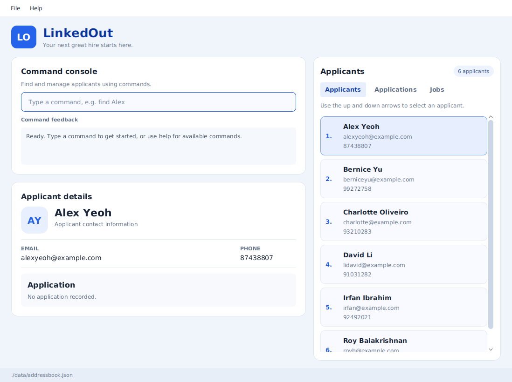
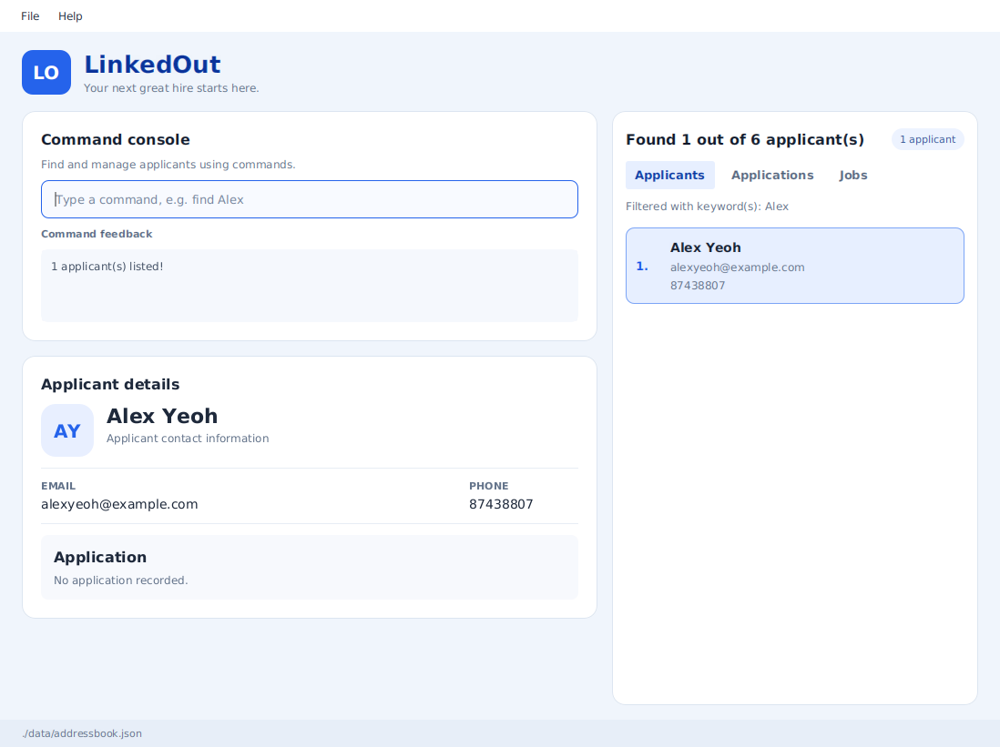

LinkedOut is a **desktop application for recruiters and HR administrators managing student applicants, job roles,
and application outcomes**. Type commands to manage your records, then review them in applicant, application,
and job lists with a detail panel for the selected record. Each applicant can have one application.

Long applicant fields and application summaries in list cards are shortened with ellipses to fit the available
width. Application status badges keep their full text. Select a record to read its full details, with job text
wrapped and the application status shown in full.

LinkedOut is a personal workspace for one recruiter. Your records are stored locally on your computer.

* Table of Contents
{:toc}

--------------------------------------------------------------------------------------------------------------------

## Quick start

1. Install Java `25`. Open a terminal and run `java -version` to check that the version shown is `25`.<br>
   **Mac users:** Follow the [Java installation instructions](https://se-education.org/guides/tutorials/javaInstallationMac.html) for your system.

2. Download `linkedout.jar` from the [LinkedOut releases page](https://github.com/AY2627S1-CS2103T-T14-3/tp/releases).
   To build the latest source instead, see the [build instructions](DevOps.md#build-automation).

3. Copy the JAR file to an empty folder where you have permission to create files. This will be your
   LinkedOut _home folder_, containing your records and preferences.

4. In the terminal, `cd` to that folder and run `java -jar "linkedout.jar"`.
   If you renamed the file, use its actual name in the command. Launching from the terminal ensures that
   LinkedOut uses the Java version you checked; double-clicking the JAR may use a different version or fail.

   On first launch, LinkedOut shows six sample applicants and three sample jobs, with no applications recorded.
   On subsequent launches, it loads your saved records.

   

5. Type a command in the command box and press Enter to execute it. For example, type **`help`** and press Enter to open the help window.<br>
   Some example commands you can try:

   * `list` : Lists all applicants.

   * `view` : Shows the applicants view.

   * `viewj` : Shows the jobs view.

   * `view 1` : Shows the first displayed applicant's details.

   * `Up` / `Down` : Selects the previous or next record in the list on screen.

   * `add -n John Doe -p 98765432 -e johnd@example.com` : Adds an applicant named `John Doe`.

   * `undo` : Restores the records from before the last change.

   * `bye` : Exits the app.

   To try the recruitment workflow with the sample data, run these commands in order:

   ```text
   list
   addp 1 -j Software Engineer Intern
   set 1 -s accept
   viewp
   ```

   The first applicant now has an accepted application for the sample Software Engineer Intern job.

6. Refer to the [Features](#features) section below for details of each command.

--------------------------------------------------------------------------------------------------------------------

## Features

To copy a value from the applicant, application, or job detail panel using the keyboard:

1. Use `view INDEX` (for example, `view 1`), `viewp`, or `viewj` to display the desired record.
2. Press `Tab` (or `Shift+Tab` to move backwards) until the desired value has a blue focus highlight.
3. Press `Ctrl+C` (Windows/Linux) or `Command+C` (macOS) to copy the focused value.

You can also right-click a value and choose **Copy**.
Names, emails, phone numbers, job roles, descriptions, and application statuses can be copied.
The complete value is copied, including text that wraps onto multiple lines. Empty values cannot be copied.

<div markdown="block" class="alert alert-info">

**:information_source: Notes about the command format:**<br>

* Words in `UPPER_CASE` are the parameters to be supplied by the user.<br>
  For example, in `add -n NAME`, replace `NAME` with a value such as `John Doe`.

* Items in square brackets are optional.<br>
  For example, `edit INDEX [-n NAME] [-p PHONE] [-e EMAIL]` can be used as `edit 1 -n John Doe -p 98765432` or as `edit 1 -n John Doe`.

* Surrounding spaces, tabs, and Unicode whitespace such as em spaces are ignored in parameter values.
  These whitespace characters can also separate an option from its value or from the preceding value.
  Internal text is preserved and must follow the field's validation rules. A required value containing only
  whitespace is treated as missing. Surrounding whitespace is also ignored around the complete command.
  Non-whitespace control characters are rejected.

* Options can be in any order. A positional index must appear before the options.<br>
  For example, if the command specifies `-n NAME -p PHONE_NUMBER`, `-p PHONE_NUMBER -n NAME` is also acceptable.

* `add` and `edit` use hyphen-prefixed options such as `-n NAME`.

* Extraneous parameters for `help` and `list` are ignored. `clear`, `bye`, and its alias `exit` reject extra parameters.<br>
  For example, `help 123` is interpreted as `help`.

* If you are using a PDF version of this document, be careful when copying and pasting commands that span multiple lines as space characters surrounding line-breaks may be omitted when copied over to the application.
</div>

### Viewing help: `help`

Opens a help window containing the User Guide link and a button to copy it.


Format: `help`


### Adding an applicant: `add`

Adds an applicant to the address book.

Each applicant must have a unique name and a unique email address. Adding or editing an applicant
to use another applicant's name or email is rejected, ignoring letter case. For example, `Amy Bee` and
`amy bee` are duplicate names, and `amy@example.com` and `Amy@Example.com` are duplicate emails.
The spelling and capitalization you enter are preserved. You can change an applicant's own capitalization with `edit`.
Saved data containing duplicate names or emails, including those differing only in case, is treated as invalid;
correct the duplicates before loading it.

Email addresses must be at most 254 characters long. The local part must start and end with a letter or digit.
It may contain adjacent supported punctuation (`+`, `_`, `.`, `-`), such as `alice__lee@example.com`,
but consecutive periods are rejected. Domain labels may contain consecutive hyphens,
including Punycode names such as `alice@xn--bcher-kva.de`, but must start and end with a letter or digit.
The length limit also applies when editing applicants and loading saved data; older records exceeding
it must be corrected before loading.

Phone numbers must contain 3 to 15 digits. An optional leading `+` and single spaces or hyphens
between digits are accepted, for example `+65 9123 4567` or `+1-202-555-0123`.
The first digit after `+` must be 1–9; local numbers without `+` may start with `0`. Formatting is preserved
when displaying and saving the number. These rules also apply to `edit` and loading saved data;
older records with more than 15 digits must be corrected before loading.

Format: `add -n NAME -p PHONE_NUMBER -e EMAIL`

Each option also accepts a long alias:

Field | Short option | Long option
------|--------------|------------
Name | `-n` | `-name`
Phone | `-p` | `-phone`
Email | `-e` | `-email`

* All three fields are required. Each option must appear exactly once and have a non-empty value.
* Phone numbers follow the 3-to-15-digit international/local format described above.
* The email local part accepts the punctuation described above, including adjacent punctuation except `..`.
  The last domain label must have at least two characters.
  These phone and email rules also apply to `edit` and saved records.
* Short and long aliases can be mixed, and options can appear in any order.
* Values containing spaces, such as a full name, do not need quotation marks.
* Names must start with a Unicode letter or digit. They can contain Unicode letters (including combining accents), digits, spaces, apostrophes (`'` or `’`), hyphens (`-`), periods (`.`), and slashes (`/`). These rules also apply to `edit`.
* Unknown options, repeated options (including different aliases for the same field), missing values, and text before the first option produce a format error with a usage hint.
* The applicant list is shown and the new applicant is selected.
* Standalone words such as `-unknown` are treated as options, even inside a value.
* The legacy `add n/NAME p/PHONE_NUMBER e/EMAIL` format is no longer accepted.

Examples:

* `add -n John Doe -p 98765432 -e johnd@example.com`
* `add -name Betsy Crowe -email betsycrowe@example.com -phone 1234567`
* `add -n Amy Lee -p +65 9123 4567 -e amy@example.com`

### Listing all applicants: `list`

Shows a list of all applicants in the address book.

Format: `list`

### Moving through the current list

Press `Up` or `Down` to select the previous or next record in the list on screen.
The detail panel updates to match. This works on the Applicants, Applications, and Jobs tabs when the
command box or a record list has focus. The command box keeps focus while you type. In feedback text,
copyable detail values, or other controls, arrow keys keep their normal editing or scrolling behavior.
The selection stops at the first and last records; an empty list has no selection.

You can still click a record, or use `view INDEX` to jump to an applicant.

### Viewing applications: `viewp`

Switches the list to the Applications tab. Each row shows the applicant's index and name, the job, and a status of Accepted, Rejected, or Pending. The index matches the applicant list, including a filtered list.

Format: `viewp [INDEX]`

* Without an index, shows the applications list.
* With an index, selects that application and shows its applicant, job, and status in the detail panel.
* `INDEX` must be the positive applicant index printed on the application row, not its position in the applications list.
  For example, if only applicant 2 has an application, select that row with `viewp 2`.
* The applicant filter is kept unchanged. After filtering applicants, use the indexes shown in the filtered list.
* When filtered, the heading shows `From N out of M applicant(s)`. These numbers count applicants, including
  those without applications; the application count badge counts the displayed applications.
* Invalid or out-of-range indexes produce an error. An applicant without an application also produces an error.

Example: `viewp 2` selects the application belonging to applicant 2 in the current applicant list.

### Editing an applicant: `edit`

Edits an existing applicant's name, phone number, or email address.

Format: `edit INDEX [-n NAME] [-p PHONE] [-e EMAIL]`

Field | Short option | Long option
------|--------------|------------
Name | `-n` | `-name`
Phone | `-p` | `-phone`
Email | `-e` | `-email`

* `INDEX` is required and selects the applicant by their index in the displayed applicant list. It must appear before the options and **must be a positive integer** 1, 2, 3, …​
* At least one of name, phone, or email must be provided. Omitted fields keep their existing values.
* Existing values will be updated to the input values.
* Short and long aliases can be mixed, and options can appear in any order. Values containing spaces do not need quotation marks.
* Unknown options, repeated options (including aliases for the same field), missing values, and extra positional text produce a format error.
* The legacy `edit INDEX n/NAME p/PHONE e/EMAIL` format is no longer accepted.
* The applicant list is shown with the edited applicant selected.

Examples:

* `edit 1 -n John Doe -e john@example.com` Edits the name and email address of the 1st applicant.
* `edit 1 -p 91234567` Edits the phone number of the 1st applicant.
* `edit 2 -name Betsy Crower` Edits the name of the 2nd applicant to be `Betsy Crower`.

### Locating applicants by name: `find`

Finds applicants whose names contain any of the given keywords.

Format: `find KEYWORD [MORE_KEYWORDS]`

* The search is case-insensitive; for example, `hans` matches `Hans`.
* Keywords are separated by whitespace, including Unicode spaces.
* Keyword order does not matter; for example, `Hans Bo` matches `Bo Hans`.
* The search considers only names.
* Only full words match; for example, `Han` does not match `Hans`.
* Applicants matching at least one keyword are returned (an `OR` search); for example, `Hans Bo` returns `Hans Gruber` and `Bo Yang`.
* The applicant list is shown, including when jobs or applications were visible.
* The list heading shows `Found N out of M applicant(s)` and the hint lists the search keywords.
  Run `list` to clear the filter and return to the full applicant list.

Examples:

* `find John` returns `john` and `John Doe`
* `find Alex` returns `Alex Yeoh`<br>
  

### Deleting an applicant: `delete`

Deletes the specified applicant from the address book.

The applicant and their application are removed together. Jobs remain in the job list. The applicant's former details
remain visible in the detail panel, marked as deleted, until you select another applicant or run another successful
applicant command.
Opening Help, either with `help` or through the menu, preserves these deleted details.
If the applicant had an application, the result includes a warning that the application was also deleted.
Deletion takes effect immediately, without a confirmation prompt.

Format: `delete INDEX`

* Deletes the applicant at the specified `INDEX`.
* The index refers to the index number shown in the displayed applicant list.
* The index **must be a positive integer** 1, 2, 3, …​

Examples:

* `list` followed by `delete 2` deletes the 2nd applicant in the address book.
* `find Betsy` followed by `delete 1` deletes the 1st applicant in the results of the `find` command.
* `undo` puts that applicant, and their application if they had one, back into the address book.

### Clearing all entries: `clear`

Deletes all applicants, applications, and jobs. This command takes effect immediately, with no confirmation.

Format: `clear`

Accepts no arguments. Extra text (e.g. `clear applicants`) is rejected without deleting any data.

The applicant list is shown. Details left on screen after a deletion are replaced by the empty detail panel.

### Exiting the program: `bye`

Exits the program without displaying a message. The command is case-sensitive and accepts no arguments or options.

Alias: `exit`, which follows the same validation and behaviour as `bye`.

Format: `bye`

### Viewing applicants: `view`

Switches to the Applicants tab, preserving the current applicant list and filter.
With an index, selects an applicant, scrolls to their entry, and shows their name, email and phone in the detail panel.
The command result display confirms the selected applicant's name.

Format: `view [INDEX]`

Use `viewp INDEX` for an application or `viewj INDEX` for a job.

* Without an index, shows the current applicant list without changing its selection. An empty list is allowed.
* `INDEX` is the positive integer shown beside an applicant in the current list.
* When the list is filtered, the index refers to that filtered list.
* The command keeps the applicant list and its filter unchanged.
* Additional or invalid arguments produce a format error with a usage hint.
  An index beyond the displayed list produces an error showing the valid range.
  Supplying an index for an empty list produces a message that there are no applicants to view.

Examples:

* `view` shows the current applicant list. Unlike `list`, it does not clear an active filter.
* `view 1` selects the first applicant in the displayed list and shows their details.
* `find Meier` followed by `view 2` shows the details of the second applicant in the search results.

### Adding an application: `addp`

Adds one job application to an applicant in the displayed list. Each applicant can have only one application.

Format: `addp INDEX -j JOB_ROLE [-s STATUS]`

* `INDEX` is the positive integer shown beside an applicant in the current list. It must appear before the options.
* When the list is filtered, the index refers to that filtered list.
* `JOB_ROLE` is the role the applicant is applying for. It cannot contain another option, such as `-s`.
* The role must already exist in the job list. Use `addj` to create it before adding an application. Matching is case-sensitive and ignores surrounding whitespace, including Unicode spaces; supply the role name, without its description.
* `STATUS` is optional. When it is omitted, the status is `pending`.
* Accepted statuses are `accept`, `reject`, and `pending`. The value is case-sensitive.
* Aliases: `-job` for `-j` and `-status` for `-s`.
* A successful command selects that applicant and shows the job and status in the detail panel.
* An applicant who already has an application cannot receive a second one.

Examples:

* `addp 1 -j Janitor` adds a pending Janitor application for the first displayed applicant.
* `addp 2 -job ClaudeGPT Expert -s accept` adds an accepted application for the second displayed applicant.

### Deleting an application: `deletep`

Deletes an applicant's application while keeping the applicant's contact details and the job in the job list.

Format: `deletep INDEX`

* `INDEX` is the positive integer shown beside an applicant in the current list, including a filtered list.
* A successful command keeps the current applicant filter, selects the applicant, and shows their details with no application recorded.
* An applicant who has no application produces an error; no records are changed.
* You can use `addp` afterwards to record a new application for the applicant.

Example:

* `find Betsy` followed by `deletep 1` deletes the application of the first applicant in the search results.

### Updating an application status: `set`

Changes the status of an application that already belongs to an applicant in the displayed list. The job description is left unchanged.

Format: `set INDEX -s STATUS`

* `INDEX` is the positive integer shown beside an applicant in the current list. It is written directly after `set`, the same way as `delete` and `view`.
* When the list is filtered, the index refers to that filtered list.
* `STATUS` is required. Accepted statuses are `accept`, `reject`, and `pending`. The value is case-sensitive.
* Alias: `-status` for `-s`.
* A successful command selects that applicant and shows the job and updated status in the detail panel.
* Feedback and status badges use `Accepted`, `Rejected`, and `Pending`; command inputs remain lowercase.
* An applicant who does not have an application cannot have a status set.

Examples:

* `set 1 -s accept` marks the first displayed applicant's application as accepted.
* `set 2 -status reject` marks the second displayed applicant's application as rejected.

### Adding a job: `addj`

Adds an open role to the job list. The list on the right switches from applicants to jobs, and the new role is selected.

Format: `addj -j JOB_ROLE [-d JOB_DESCRIPTION]`

* `JOB_ROLE` is the role name. It cannot be blank. Surrounding spaces are removed from both the role and description; values containing spaces do not need quotation marks.
* `JOB_DESCRIPTION` is optional. If omitted, it is stored and displayed as `No information ~`. If `-d` is supplied, its value must not be empty.
* Alias: `-job` for `-j`, and `-description`, `-desc` for `-d`.
* A role that is already in the list cannot be added again, even with a different description. Matching ignores surrounding spaces and is otherwise case-sensitive. Different roles may share a description.
* Adding a role does not create an application. Use `addp` to record an applicant's application for a role.

Examples:

* `addj -j Software Engineer Intern` adds that role and shows it in the job list.
* `addj -job Data Analyst -desc Analyses the data` adds a Data Analyst role.

### Editing a job: `editj`

Edits a job's role, description, or both. The full job list is shown after a successful edit, with the edited job selected.

Format: `editj INDEX [-j JOB_ROLE] [-d JOB_DESCRIPTION]`

* `INDEX` is the positive integer shown beside a job in the current job list, including a filtered list.
* Supply at least one field. Omitted fields keep their existing values.
* Role alias: `-job` for `-j`. Description aliases: `-desc` and `-description` for `-d`.
* A supplied description must not be empty. To change a description, supply its complete replacement text.
* A supplied role cannot be blank, including Unicode whitespace such as an em space.
* The new role cannot match another stored job. Matching ignores surrounding spaces and is otherwise case-sensitive. Keeping the current role is allowed.
* The job keeps its position in the full list. Any job filter is cleared so the edited role remains visible.
* Applications for the job immediately reference the updated role and description. Their applicants and statuses are kept.
* An empty list, an invalid index, missing edit fields, empty values, or a duplicate role produces an error and leaves the jobs unchanged.

Examples:

* `viewj` followed by `editj 2 -j Senior Software Engineer` renames the second job, keeping its description.
* `editj 1 -d Build internal recruitment tools` changes only the first displayed job's description.
* `viewj -f data` followed by `editj 1 -job Product Analyst` renames the first matching job and shows all jobs again.

### Viewing jobs: `viewj`

Shows open roles. The list on the right switches to jobs, and the detail panel shows the selected role.

Format: `viewj [INDEX]` or `viewj [-f KEYWORD]`

* Without any arguments, every job is shown.
* `INDEX` selects a job using its positive index in the current job list and shows its details, keeping the job filter.
  Invalid or out-of-range indexes produce an error; an empty list produces a message that there are no jobs to view.
* An index and `-f` cannot be used together. Filter first, then select a job from the results.
* `-f KEYWORD` searches the combined text `ROLE : DESCRIPTION`. Matching ignores case and does not need a full word, so `jan` matches the role `Janitor`. Text found only in the description also matches. A multi-word keyword is matched as one substring.
* Alias: `-filter` for `-f`.
* A filtered list shows `Found N out of M job(s)` and the filter keyword in the hint. Run bare `viewj` to clear it.
* The command word is case-sensitive. `Viewj` is not recognised.
* `editj` and `deletej` use the index in the list currently displayed, including a filtered list.
* `list`, `view`, `find`, `add`, `edit`, and `clear` switch the list back to applicants. `viewp` switches to applications.

Examples:

* `viewj` lists every job. An empty list shows "No jobs to display."
* `viewj -f jan` lists roles such as Janitor.
* `viewj -f jan` followed by `viewj 1` selects the first matching job and keeps the filtered list.
* After `addj -j Research Assistant -d Analyse survey responses`, `viewj -f survey` includes that job because its description matches.

### Deleting a job: `deletej`

Deletes the role at the displayed index. The list stays on jobs.

Format: `deletej INDEX`

* `INDEX` is the positive integer shown beside a job in the job list currently displayed. After `viewj -f jan`, index 1 is the first matching job.
* Deleting a role also deletes all applications with the same job role. Applicants and their contact details are kept.
* If applications were removed, the result includes a warning with the number deleted, including those hidden by a filter. Deletion takes effect immediately, without a confirmation prompt.
* Job roles are matched exactly after trimming surrounding spaces; different letter cases identify different jobs.
* An empty list, a missing index, or an index past the end of the list produces an error and leaves the jobs unchanged.

Examples:

* `deletej 1` deletes the first job.
* `viewj` followed by `deletej 2` deletes the second job.
* `undo` puts that job back, together with the applications that were removed with it.

### Undoing the last change: `undo`

Restores applicants, jobs, and applications to the state before the most recent command that changed them.
Use this after deleting or editing the wrong record.

Format: `undo`

* The command accepts no arguments.
* Only changes to stored records are undone. `list`, `find`, `view`, `viewp`, and `viewj` do not count as changes.
* Each `undo` steps back one change, up to the ten most recent changes in this session.
* Closing LinkedOut clears this history. The restored records are saved in the usual way.
* The current tab and list filters stay where they are. Use `list` or `viewj` if a restored record is hidden by a filter.
* There is no `redo` command.

Examples:

* `delete 1` followed by `undo` restores that applicant.
* `deletej 2` followed by `undo` restores that job and any applications removed with it.
* `clear` followed by `undo` restores all applicants, jobs, and applications removed by the clear.
* `editj 1 -d Revised description` followed by `undo` restores the job's previous description.
* `add -n John Doe -p 98765432 -e johnd@example.com` followed by `undo` removes John Doe again.

### Saving the data

LinkedOut automatically saves data after every successfully executed command. You do not need to save manually.

### Editing the data file

LinkedOut saves records in `data/addressbook.json` relative to the folder from which you launch it.
Following the quick start keeps this file in your LinkedOut home folder. Advanced users can edit this JSON file
while the application is closed. Back it up before making changes.

<div markdown="span" class="alert alert-warning">:exclamation: **Caution:**
If your changes make the data file invalid, LinkedOut starts with empty lists on the next run.
The invalid file remains on disk until a successfully executed command saves the in-memory records over it.
Restore your backup before continuing if your records fail to load. JSON `null` as the whole file or as an
entry in any record array is invalid too.<br>
Values outside the accepted ranges can cause loading errors or unexpected behavior. Edit the file only if you
are confident that you can update it correctly.
</div>

#### Record collections

The JSON file contains an `applicants` array and separate `jobs` and `applications` arrays. Applicant entries
contain `name`, `phone`, and `email`. An application's `name` must match its applicant's stored name exactly,
including case, and its `status` must be `accept`, `reject`, or `pending`. Each applicant can have at most one
application. For example:

```json
{
  "applicants": [{"name": "Alex Tan", "phone": "91234567", "email": "alex@example.com"}],
  "jobs": [{"role": "Research Assistant", "description": "Analyse survey responses"}],
  "applications": [{
    "name": "Alex Tan",
    "job": {"role": "Research Assistant", "description": "Analyse survey responses"},
    "status": "pending"
  }]
}
```

Older contact files using the `persons` array instead of `applicants` are not automatically migrated. Back up
the file before renaming that array, and check the field constraints and application references before loading.

#### Job data format

Each entry in `jobs` is an object with a non-blank `role` and a `description` string, for example
`{"role": "Research Assistant", "description": "Analyse survey responses"}`. The description may be an empty
string in the data file, but it must be present and cannot be `null`. Role names must be unique after removing
surrounding spaces; comparisons are case-sensitive.

Each application stores its job as an object with the same two fields. Its role must match an entry in `jobs`.
When loading, the application uses the matching job from `jobs`, including that job's description.

**Compatibility:** Older files with jobs stored as strings or without a `role` field are not automatically
migrated. Back up the file before updating it. Convert each job to the object format above, including the `job`
inside each application, and ensure every application refers to a role in `jobs`.

--------------------------------------------------------------------------------------------------------------------

## FAQ

**Q**: How do I transfer my data to another computer?<br>
**A**: Close LinkedOut on both computers. Copy `linkedout.jar` and `data/addressbook.json` from your LinkedOut
home folder to the same layout in a writable folder on the other computer. Ensure Java `25` is installed there,
then launch LinkedOut from that folder as described in the quick start.

--------------------------------------------------------------------------------------------------------------------

## Known issues

1. **When using multiple screens**, if you move the application to a secondary screen, and later switch to using only the primary screen, the GUI will open off-screen. The remedy is to delete the `preferences.json` file created by the application before running the application again.
2. **If you minimize the Help Window** and then run the `help` command (or use the `Help` menu, or the keyboard shortcut `F1`) again, the original Help Window will remain minimized, and no new Help Window will appear. The remedy is to manually restore the minimized Help Window.

--------------------------------------------------------------------------------------------------------------------

## Command summary

Action | Format, Examples
--------|------------------
**Add** | `add -n NAME -p PHONE_NUMBER -e EMAIL` <br> e.g., `add -n James Ho -p 22224444 -e jamesho@example.com`
**Add application** | `addp INDEX -j JOB_ROLE [-s STATUS]`<br> e.g., `addp 1 -j Janitor -s pending`
**Delete application** | `deletep INDEX`<br> e.g., `deletep 1`
**Set application status** | `set INDEX -s STATUS`<br> e.g., `set 1 -s accept`
**Add job** | `addj -j JOB_ROLE [-d JOB_DESCRIPTION]`<br> e.g., `addj -j Software Engineer`
**Edit job** | `editj INDEX [-j JOB_ROLE] [-d JOB_DESCRIPTION]`<br> e.g., `editj 1 -j Senior Software Engineer`
**View jobs** | `viewj [INDEX]` or `viewj [-f KEYWORD]`<br> e.g., `viewj 1` or `viewj -f engineer`
**Delete job** | `deletej INDEX`<br> e.g., `deletej 1`
**Clear** | `clear`
**Delete** | `delete INDEX`<br> e.g., `delete 3`
**Undo** | `undo`
**Edit** | `edit INDEX [-n NAME] [-p PHONE] [-e EMAIL]`<br> e.g., `edit 1 -p 91234567 -e john@example.com`
**Find** | `find KEYWORD [MORE_KEYWORDS]`<br> e.g., `find James Jake`
**List** | `list`
**View applicants** | `view [INDEX]`<br> e.g., `view 1`
**View applications** | `viewp [INDEX]`<br> e.g., `viewp 2` (uses the displayed applicant index)
**Select previous / next** | `Up` / `Down`
**Help** | `help`
**Bye** | `bye` or `exit`
