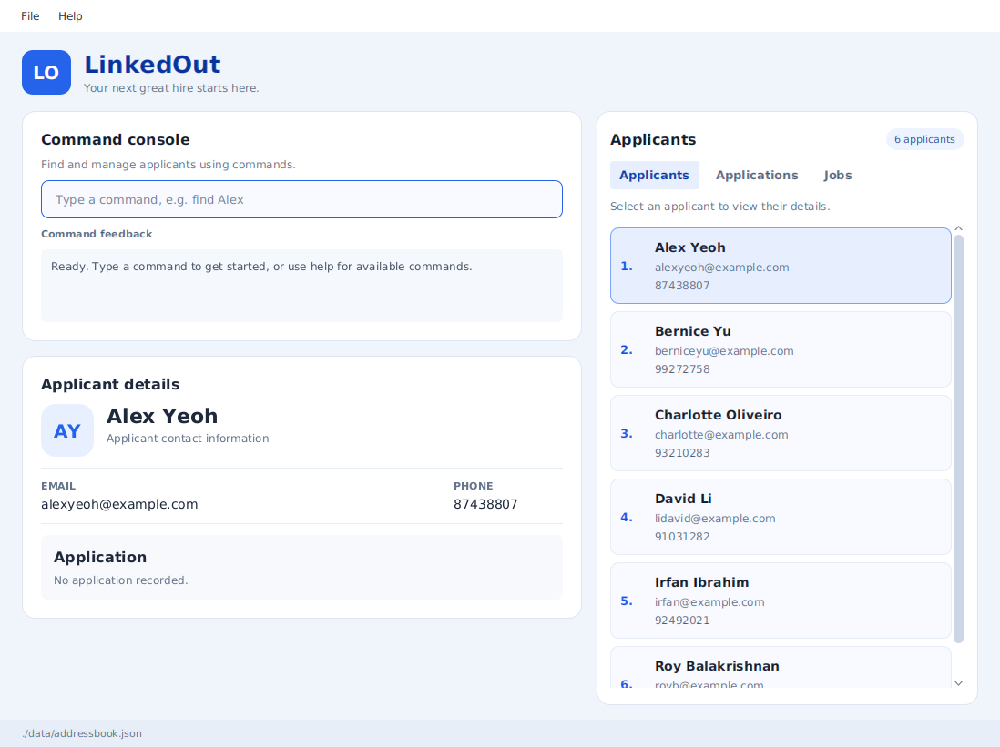
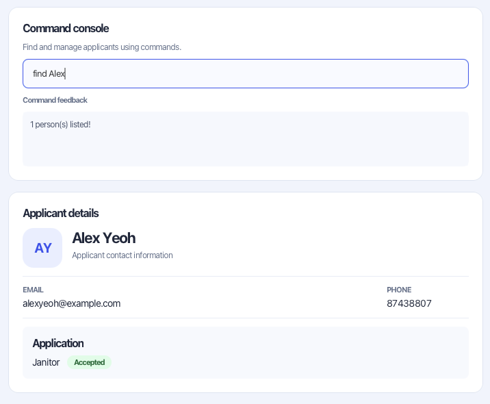

AddressBook Level 3 (AB3) is a **desktop application for managing contacts, optimized for use through a Command Line Interface (CLI)** while retaining the benefits of a Graphical User Interface (GUI). If you type quickly, AB3 can help you manage contacts faster than traditional GUI applications.

* Table of Contents
{:toc}

--------------------------------------------------------------------------------------------------------------------

## Quick start

1. Ensure that Java `25` or later is installed on your computer. 
   **Mac users:** Ensure you have the precise JDK version prescribed [here](https://se-education.org/guides/tutorials/javaInstallationMac.html).

1. Download the latest `.jar` file from [here](https://github.com/se-edu/addressbook-level3/releases).

1. Copy the file to the folder you want to use as the _home folder_ for your AddressBook.

1. Open a terminal, `cd` to the folder containing the JAR file, and run `java -jar addressbook.jar`. 
   A GUI similar to the one below should appear in a few seconds. Note how the app contains some sample data. 
   

1. Type a command in the command box and press Enter to execute it. For example, type **`help`** and press Enter to open the help window. 
   Some example commands you can try:

   * `list` : Lists all contacts.

   * `add -n John Doe -p 98765432 -e johnd@example.com` : Adds a contact named `John Doe` to the Address Book.

   * `delete 3` : Deletes the 3rd contact shown in the current list.

   * `clear` : Deletes all contacts.

   * `bye` : Exits the app.

1. Refer to the [Features](#features) section below for details of each command.

--------------------------------------------------------------------------------------------------------------------

## Features

**:information_source: Notes about the command format:** 

* Words in `UPPER_CASE` are the parameters to be supplied by the user. 
  For example, in `add -n NAME`, replace `NAME` with a value such as `John Doe`.

* Items in square brackets are optional. 
  For example, `edit INDEX [-n NAME] [-p PHONE] [-e EMAIL]` can be used as `edit 1 -n John Doe -p 98765432` or as `edit 1 -n John Doe`.

* Options can be in any order. A positional index must appear before the options. 
  For example, if the command specifies `-n NAME -p PHONE_NUMBER`, `-p PHONE_NUMBER -n NAME` is also acceptable.

* `add` and `edit` use hyphen-prefixed options such as `-n NAME`.

* Extraneous parameters for `help`, `list`, and `clear` are ignored. `bye` and its alias `exit` reject extra parameters. 
  For example, `help 123` is interpreted as `help`.

* If you are using a PDF version of this document, be careful when copying and pasting commands that span multiple lines as space characters surrounding line-breaks may be omitted when copied over to the application.

### Viewing help: `help`

Shows a message explaining how to access the help page.

Format: `help`

### Adding a person: `add`

Adds a person to the address book.

Each applicant must have a unique name and a unique email address. Adding or editing an applicant
to use another applicant's name or email is rejected. Comparisons are case-sensitive.
Saved data containing duplicate names or emails is treated as invalid; correct the duplicates before loading it.

Format: `add -n NAME -p PHONE_NUMBER -e EMAIL`

Each option also accepts a long alias:

Field | Short option | Long option
------|--------------|------------
Name | `-n` | `-name`
Phone | `-p` | `-phone`
Email | `-e` | `-email`

* All three fields are required. Each option must appear exactly once and have a non-empty value.
* Short and long aliases can be mixed, and options can appear in any order.
* Values containing spaces, such as a full name, do not need quotation marks.
* Unknown options, repeated options (including different aliases for the same field), missing values, and text before the first option produce a format error with a usage hint.
* Standalone words such as `-unknown` are treated as options, even inside a value.
* The legacy `add n/NAME p/PHONE_NUMBER e/EMAIL` format is no longer accepted.

Examples:

* `add -n John Doe -p 98765432 -e johnd@example.com`
* `add -name Betsy Crowe -email betsycrowe@example.com -phone 1234567`

### Listing all persons: `list`

Shows a list of all persons in the address book.

Format: `list`

### Editing an applicant: `edit`

Edits an existing applicant's name, phone number, or email address.

Format: `edit INDEX [-n NAME] [-p PHONE] [-e EMAIL]`

Field | Short option | Long option
------|--------------|------------
Name | `-n` | `-name`
Phone | `-p` | `-phone`
Email | `-e` | `-email`

* `INDEX` is required and selects the applicant by their index in the displayed person list. It must appear before the options and **must be a positive integer** 1, 2, 3, …​
* At least one of name, phone, or email must be provided. Omitted fields keep their existing values.
* Existing values will be updated to the input values.
* Short and long aliases can be mixed, and options can appear in any order. Values containing spaces do not need quotation marks.
* Unknown options, repeated options (including aliases for the same field), missing values, and extra positional text produce a format error.
* The legacy `edit INDEX n/NAME p/PHONE e/EMAIL` format is no longer accepted.

Examples:

* `edit 1 -n John Doe -e john@example.com` Edits the name and email address of the 1st applicant.
* `edit 1 -p 91234567` Edits the phone number of the 1st applicant.
* `edit 2 -name Betsy Crower` Edits the name of the 2nd applicant to be `Betsy Crower`.

### Locating persons by name: `find`

Finds persons whose names contain any of the given keywords.

Format: `find KEYWORD [MORE_KEYWORDS]`

* The search is case-insensitive; for example, `hans` matches `Hans`.
* Keyword order does not matter; for example, `Hans Bo` matches `Bo Hans`.
* The search considers only names.
* Only full words match; for example, `Han` does not match `Hans`.
* Persons matching at least one keyword are returned (an `OR` search); for example, `Hans Bo` returns `Hans Gruber` and `Bo Yang`.

Examples:
* `find John` returns `john` and `John Doe`
* `find Alex` returns `Alex Yeoh` 
  

### Deleting a person: `delete`

Deletes the specified person from the address book.

The applicant and their application are removed together. Their former details remain visible in the
detail panel, marked as deleted, until you select another applicant or run another successful applicant command.
Opening Help, either with `help` or through the menu, preserves these deleted details.

Format: `delete INDEX`

* Deletes the person at the specified `INDEX`.
* The index refers to the index number shown in the displayed person list.
* The index **must be a positive integer** 1, 2, 3, …​

Examples:
* `list` followed by `delete 2` deletes the 2nd person in the address book.
* `find Betsy` followed by `delete 1` deletes the 1st person in the results of the `find` command.

### Clearing all entries: `clear`

Clears all entries from the address book.

Format: `clear`

### Exiting the program: `bye`

Exits the program without displaying a message. The command is case-sensitive and accepts no arguments or options.

Alias: `exit`, which follows the same validation and behaviour as `bye`.

Format: `bye`

### Viewing an applicant: `view`

Selects an applicant in the list, scrolls to their entry, and shows their name, email and phone in the applicant detail panel.
The command result display confirms the applicant's name.

Format: `view INDEX`

* `INDEX` is the positive integer shown beside an applicant in the current list.
* When the list is filtered, the index refers to that filtered list.
* The command keeps the applicant list and its filter unchanged.
* Missing, additional, or invalid arguments produce a format error with a usage hint.
  An index beyond the displayed list produces an error showing the valid range.
  An empty list produces a message that there are no applicants to view.

Examples:

* `view 1` selects the first applicant in the displayed list and shows their details.
* `find Meier` followed by `view 2` shows the details of the second applicant in the search results.

### Adding an application: `addp`

Adds one job application to an applicant in the displayed list. Each applicant can have only one application.

Format: `addp INDEX -j JOB_ROLE [-s STATUS]`

* `INDEX` is the positive integer shown beside an applicant in the current list. It must appear before the options.
* When the list is filtered, the index refers to that filtered list.
* `JOB_ROLE` is the role the applicant is applying for. It cannot contain another option, such as `-s`.
* `STATUS` is optional. When it is omitted, the status is `pending`.
* Accepted statuses are `accept`, `reject`, and `pending`. The value is case-sensitive.
* Aliases: `-job` for `-j` and `-status` for `-s`.
* A successful command selects that applicant and shows the job and status in the detail panel.
* An applicant who already has an application cannot receive a second one.

Examples:

* `addp 1 -j Janitor` adds a pending Janitor application for the first displayed applicant.
* `addp 2 -job ClaudeGPT Expert -s accept` adds an accepted application for the second displayed applicant.

### Updating an application status: `set`

Changes the status of an application that already belongs to an applicant in the displayed list. The job description is left unchanged.

Format: `set INDEX -s STATUS`

* `INDEX` is the positive integer shown beside an applicant in the current list. It is written directly after `set`, the same way as `delete` and `view`.
* When the list is filtered, the index refers to that filtered list.
* `STATUS` is required. Accepted statuses are `accept`, `reject`, and `pending`. The value is case-sensitive.
* Alias: `-status` for `-s`.
* A successful command selects that applicant and shows the job and updated status in the detail panel.
* An applicant who does not have an application cannot have a status set.

Examples:

* `set 1 -s accept` marks the first displayed applicant's application as accepted.
* `set 2 -status reject` marks the second displayed applicant's application as rejected.

### Adding a job: `addj`

Adds an open role to the job list. The list on the right switches from applicants to jobs, and the new role is selected.

Format: `addj -j JOB_ROLE [-d JOB_DESCRIPTION]`

* `JOB_ROLE` is the role name. It cannot be blank.
* `JOB_DESCRIPTION` is the description for the job. It is an optional field.
* Alias: `-job` for `-j`, and `-description`, `-desc` for `-d`.
* A role that is already in the list cannot be added again. Matching ignores surrounding spaces and is otherwise case-sensitive.
* Adding a role does not create an application. Use `addp` to record an applicant's application for a role.

Examples:

* `addj -j Software Engineer Intern` adds that role and shows it in the job list.
* `addj -job Data Analyst -desc Analyses the data` adds a Data Analyst role.

### Editing a job: `editj`

Replaces a job's description. The full job list is shown after a successful edit, with the edited role selected.

Format: `editj INDEX -j JOB_DESCRIPTION`

* `INDEX` is the positive integer shown beside a job in the current job list, including a filtered list.
* `JOB_DESCRIPTION` is required and follows the same rules as `addj`. Alias: `-job` for `-j`.
* The new description cannot match another stored job. Matching ignores surrounding spaces and is otherwise case-sensitive. Keeping the current description is allowed.
* The job keeps its position in the full list. Any job filter is cleared so the edited role remains visible.
* Editing a job leaves applicants and their application descriptions unchanged.
* An empty list, an invalid index, a missing description, or a duplicate description produces an error and leaves the jobs unchanged.

Examples:

* `viewj` followed by `editj 2 -j Senior Software Engineer` renames the second job.
* `viewj -f data` followed by `editj 1 -job Product Analyst` renames the first matching job and shows all jobs again.

### Viewing jobs: `viewj`

Shows open roles. The list on the right switches to jobs, and the detail panel shows the selected role.

Format: `viewj [-f KEYWORD]`

* Without `-f`, every job is shown.
* `-f KEYWORD` shows roles whose description contains `KEYWORD`. Matching ignores case and does not need a full word, so `jan` matches `Janitor`.
* Alias: `-filter` for `-f`.
* The command word is case-sensitive. `Viewj` is not recognised.
* `editj` and `deletej` use the index in the list currently displayed, including a filtered list.
* Other commands, such as `list` and `view`, switch the list back to applicants.

Examples:

* `viewj` lists every job. An empty list shows "No jobs to display."
* `viewj -f jan` lists roles such as Janitor.

### Deleting a job: `deletej`

Deletes the role at the displayed index. The list stays on jobs.

Format: `deletej INDEX`

* `INDEX` is the positive integer shown beside a job in the job list currently displayed. After `viewj -f jan`, index 1 is the first matching job.
* Deleting a role does not delete applicants or their applications.
* An empty list, a missing index, or an index past the end of the list produces an error and leaves the jobs unchanged.

Examples:

* `deletej 1` deletes the first job.
* `viewj` followed by `deletej 2` deletes the second job.

### Saving the data

AddressBook automatically saves data after every command. You do not need to save manually.

### Editing the data file

AddressBook data is saved automatically as a JSON file `[JAR file location]/data/addressbook.json`. Advanced users are welcome to update data directly by editing that data file.

:exclamation: **Caution:**
If your changes make the data file invalid, AddressBook starts with an empty address book at the next run. The invalid file remains on disk until you run a command (AddressBook saves after every command). Still, we recommend backing up the file before editing it. 
Furthermore, certain edits can cause the AddressBook to behave in unexpected ways (e.g., if a value entered is outside of the acceptable range). Therefore, edit the data file only if you are confident that you can update it correctly.

### Archiving data files `[coming in v2.0]`

_Details coming soon ..._

--------------------------------------------------------------------------------------------------------------------

## FAQ

**Q**: How do I transfer my data to another computer? 
**A**: Install the app on the other computer and overwrite the data file it creates with the data file from your previous AddressBook home folder.

--------------------------------------------------------------------------------------------------------------------

## Known issues

1. **When using multiple screens**, if you move the application to a secondary screen, and later switch to using only the primary screen, the GUI will open off-screen. The remedy is to delete the `preferences.json` file created by the application before running the application again.
2. **If you minimize the Help Window** and then run the `help` command (or use the `Help` menu, or the keyboard shortcut `F1`) again, the original Help Window will remain minimized, and no new Help Window will appear. The remedy is to manually restore the minimized Help Window.

--------------------------------------------------------------------------------------------------------------------

## Command summary

Action | Format, Examples
--------|------------------
**Add** | `add -n NAME -p PHONE_NUMBER -e EMAIL`   e.g., `add -n James Ho -p 22224444 -e jamesho@example.com`
**Add application** | `addp INDEX -j JOB_ROLE [-s STATUS]`  e.g., `addp 1 -j Janitor -s pending`
**Set application status** | `set INDEX -s STATUS`  e.g., `set 1 -s accept`
**Add job** | `addj -j JOB_DESCRIPTION`  e.g., `addj -j Software Engineer`
**Edit job** | `editj INDEX -j JOB_DESCRIPTION`  e.g., `editj 1 -j Senior Software Engineer`
**View jobs** | `viewj [-f KEYWORD]`  e.g., `viewj -f engineer`
**Delete job** | `deletej INDEX`  e.g., `deletej 1`
**Clear** | `clear`
**Delete** | `delete INDEX`  e.g., `delete 3`
**Edit** | `edit INDEX [-n NAME] [-p PHONE] [-e EMAIL]`  e.g., `edit 1 -p 91234567 -e john@example.com`
**Find** | `find KEYWORD [MORE_KEYWORDS]`  e.g., `find James Jake`
**List** | `list`
**View** | `view INDEX`  e.g., `view 1`
**Help** | `help`
**Bye** | `bye` or `exit`
